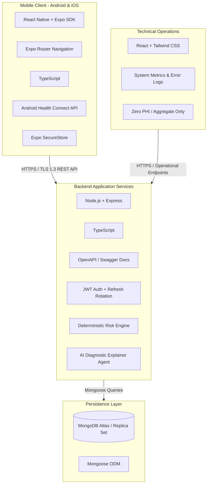

# VitaTrack — Vitamin D Deficiency Self-Diagnosis & Guidance Platform

> **Academic Research & Project Origin:** Based on the study and design by **Satyam Kumar (B.Tech)** and **Shilpi Shikha (BPT)**, supervised by **Dr. Hoshiyar Singh** (Dean of Agriculture Department), **Vivekananda Global University (VGU Jaipur)**.

[](https://github.com/SatyamKumar-code/VitaTrack-App/releases)
[](https://vitatrack-app-zvrg.onrender.com)
[](https://github.com/SatyamKumar-code/VitaTrack-App/releases/latest/download/VitaTrack.apk)
[](https://github.com/SatyamKumar-code/VitaTrack-App/releases/latest/download/VitaTrack.ipa)
[]()

---

## 🚀 Live Demo & Mobile App Downloads

| Platform | Access / Direct Download Link | Description |
|:---|:---|:---|
| **🌐 Live Web App** | [**vitatrack-app-zvrg.onrender.com**](https://vitatrack-app-zvrg.onrender.com) | Instant access directly in any web or mobile browser (Chrome, Safari, Edge). |
| **🤖 Android APK (GitHub)** | [⬇️ **Download VitaTrack.apk (Direct)**](https://github.com/SatyamKumar-code/VitaTrack-App/releases/latest/download/VitaTrack.apk) | Direct download with filename **`VitaTrack.apk`** from GitHub Releases. |
| **📦 Release History** | [**View All GitHub Releases**](https://github.com/SatyamKumar-code/VitaTrack-App/releases) | View all version tags, changelog, and binaries. |
| **🍏 iOS App (.ipa)** | [⬇️ **Download VitaTrack.ipa (GitHub)**](https://github.com/SatyamKumar-code/VitaTrack-App/releases/latest/download/VitaTrack.ipa) | Native iOS build binary (`.ipa` / Simulator) for iPhone & iPad. |
| **💻 Admin Portal** | [**Open Admin Dashboard**](https://vitatrack-app-zvrg.onrender.com) | Operations & technical telemetry monitor (Zero-PHI aggregate metrics). |

### 📲 How to Install & Run

#### 1. Android (.apk) Installation
1. Click [⬇️ **Direct Download VitaTrack.apk**](https://github.com/SatyamKumar-code/VitaTrack-App/releases/latest/download/VitaTrack.apk) to immediately download `VitaTrack.apk` directly on your Android device.
2. Once downloaded, tap the `VitaTrack.apk` file and select **Install** *(if prompted by Android, toggle on "Allow from this source" in Chrome / Files settings)*.
3. Open **VitaTrack** and register / log in to access the symptom assessment, solar calculator, and health telemetry.
4. *(Developer Build)* To generate a fresh standalone APK locally:
   ```bash
   cd apps/mobile
   npm install
   npx eas-cli build --platform android --profile preview
   ```

#### 2. iOS (iPhone / iPad) Installation

- **Option A (Native iOS .ipa via Sideloading / AltStore):**
  1. Download [**VitaTrack.ipa**](https://github.com/SatyamKumar-code/VitaTrack-App/releases/latest/download/VitaTrack.ipa) from GitHub Releases.
  2. Sideload onto your iPhone using **AltStore**, **Sideloadly**, or **TrollStore** (free with your regular Apple ID).
- **Option B (Instant Testing via Expo Go):**
  1. Install **Expo Go** from the Apple App Store.
  2. Run `npm run start` in `apps/mobile` and scan the QR code with your iPhone camera to launch the native app instantly!
- **Option C (Build Native iOS Binary via EAS):**
  ```bash
  cd apps/mobile
  # For iOS Simulator build (No Apple Developer account required):
  npx eas-cli build --platform ios --profile preview

  # For Real iPhone Device .ipa (Requires Apple Developer account):
  npx eas-cli build --platform ios --profile preview-device
  ```
- **Option D (Instant Web App / PWA):**
  Open [https://vitatrack-app-zvrg.onrender.com](https://vitatrack-app-zvrg.onrender.com) in **Safari**, tap **Share** -> **"Add to Home Screen"**.

---

## 1. Executive Summary & Problem Context

Vitamin D deficiency is one of the most underdiagnosed global health conditions across all demographics and age groups. Symptoms such as chronic fatigue, persistent bone pain, muscle weakness, mood fluctuations, and frequent infections are frequently overlooked or misattributed. In rural and remote regions, specialized diagnostic endocrinology and clinical testing facilities are often inaccessible, leading to delayed medical intervention and compounding healthcare burdens.

**VitaTrack** is conceived as a smart, accessible, self-diagnosis and lifestyle guidance mobile platform. It bridges the critical awareness and screening gap by combining:
- Comprehensive multi-factor self-assessments (symptoms, solar exposure, nutritional habits, and medical risk history).
- Transparent, deterministic risk scoring coupled with AI-assisted clinical insights.
- Tailored lifestyle, dietary, and safe solar exposure recommendations.
- Smartwatch biometric telemetry ingestion via Android Health Connect.
- Longitudinal health tracking and exportable clinician-ready health reports.

> [!IMPORTANT]
> **Medical Disclaimer & Health Safety Boundary:**  
> VitaTrack is strictly a **self-assessment screening, educational, and preventive lifestyle guidance platform**. It does **not** provide definitive clinical medical diagnoses, nor does symptom-based risk scoring replace laboratory venous blood serum testing ($25(\text{OH})\text{D}$). The platform actively prompts users with elevated risk indicators to seek formal medical consultation with qualified healthcare professionals.

---

## 2. Master Documentation Index

This repository strictly adheres to a multi-phase, specification-first engineering discipline. All architectural, clinical, technical, and operational requirements are organized within the `docs/` directory:

| # | Documentation File | Purpose & Scope |
|---|--------------------|-----------------|
| 1 | [README.md](file:///e:/VitaTrack/README.md) | Project overview, academic origin, documentation sitemap, and directory. |
| 2 | [docs/AGENTS.md](file:///e:/VitaTrack/docs/AGENTS.md) | Mandatory behavioral rules and constraints for AI coding agents. |
| 3 | [docs/PROJECT_PLAN.md](file:///e:/VitaTrack/docs/PROJECT_PLAN.md) | Multi-phase development roadmap (Phases 0–10 + Future Scope). |
| 4 | [docs/REQUIREMENTS.md](file:///e:/VitaTrack/docs/REQUIREMENTS.md) | Functional (FR) and non-functional (NFR) requirements, PPT mapping. |
| 5 | [docs/ARCHITECTURE.md](file:///e:/VitaTrack/docs/ARCHITECTURE.md) | System components, C4 models, data pipelines, and privacy barriers. |
| 6 | [docs/TASKS.md](file:///e:/VitaTrack/docs/TASKS.md) | Granular, ordered implementation task backlog with acceptance criteria. |
| 7 | [docs/TEST_PLAN.md](file:///e:/VitaTrack/docs/TEST_PLAN.md) | Test strategies across unit, integration, UI, wearable, and privacy tiers. |
| 8 | [docs/TEST_REPORT.md](file:///e:/VitaTrack/docs/TEST_REPORT.md) | Quality ledger recording automated tests, executions, and verification status. |
| 9 | [docs/API_SPEC.md](file:///e:/VitaTrack/docs/API_SPEC.md) | Complete OpenAPI / REST contracts, schemas, headers, and error codes. |
| 10 | [docs/DATABASE_SCHEMA.md](file:///e:/VitaTrack/docs/DATABASE_SCHEMA.md) | MongoDB collections, indexes, BSON types, and data retention rules. |
| 11 | [docs/SECURITY_PRIVACY.md](file:///e:/VitaTrack/docs/SECURITY_PRIVACY.md) | PHI protection, JWT auth, encryption, and zero-PHI admin privacy boundaries. |
| 12 | [docs/SMARTWATCH_INTEGRATION.md](file:///e:/VitaTrack/docs/SMARTWATCH_INTEGRATION.md) | Android Health Connect architecture, metric ingestion, and vendor bridges. |
| 13 | [docs/DEVICE_COMPATIBILITY.md](file:///e:/VitaTrack/docs/DEVICE_COMPATIBILITY.md) | Android OS, Wear OS, and manufacturer wearable compatibility matrix. |
| 14 | [docs/ADMIN_DASHBOARD.md](file:///e:/VitaTrack/docs/ADMIN_DASHBOARD.md) | Technical operations portal for uptime, error telemetry, and zero-PHI stats. |
| 15 | [docs/ADVERTISING_PLAN.md](file:///e:/VitaTrack/docs/ADVERTISING_PLAN.md) | Future ethical, privacy-preserving monetization strategy (**unimplemented**). |
| 16 | [docs/UI_UX_SPEC.md](file:///e:/VitaTrack/docs/UI_UX_SPEC.md) | Design system, screens, wireflows, animations, and accessibility specs. |
| 17 | [docs/DEPLOYMENT.md](file:///e:/VitaTrack/docs/DEPLOYMENT.md) | EAS build pipelines, Docker containerization, and release engineering. |
| 18 | [docs/CHANGELOG.md](file:///e:/VitaTrack/docs/CHANGELOG.md) | Versioning ledger following the Keep a Changelog standard. |
| 19 | [docs/DECISIONS.md](file:///e:/VitaTrack/docs/DECISIONS.md) | Architecture Decision Records (ADRs) explaining technical trade-offs. |
| 20 | [docs/AI_PROGRESS.md](file:///e:/VitaTrack/docs/AI_PROGRESS.md) | AI tracking ledger showing current phase, blockers, and next actions. |

---

## 3. Technology Stack Summary



- **Mobile Application:** React Native with Expo SDK and TypeScript.
- **Client Routing:** Expo Router (file-based navigation).
- **Backend API:** Node.js, Express, TypeScript, structured in layered modular architecture.
- **Database:** MongoDB with Mongoose ODM, utilizing compound and TTL indexing.
- **Wearable Abstraction:** Android Health Connect API (SpO₂, Heart Rate, Sleep Stages, Activity).
- **Admin Dashboard:** React, Vite, and Tailwind CSS (technical telemetry and aggregate system metrics only).
- **Codebase Architecture:** Strict **Feature-Based (Vertical Slice)** organization across `apps/mobile`, `apps/backend`, and `apps/admin` (detailed in [docs/ARCHITECTURE.md](file:///e:/VitaTrack/docs/ARCHITECTURE.md) and [docs/DECISIONS.md: ADR-009](file:///e:/VitaTrack/docs/DECISIONS.md)).
- **Build & Distribution:** Expo Application Services (EAS Build) producing signed Android Application Bundles (`.aab`) and debug APKs (`.apk`).

---

## 4. Multi-Phase Implementation Roadmap Overview

VitaTrack is partitioned into modular, verifiable development phases:

- **Phase 0:** Requirements, Clinical Mapping & Architecture Documentation (*Complete*)
- **Phase 1:** Project Scaffolding, Tooling & Environment Configuration (*Complete & Verified*)
- **Phase 2:** Authentication Engine, Security Vault & User Profile Management (*Complete & Verified*)
- **Phase 3:** Clinical Self-Assessment Questionnaire & Interactive Engine (*Complete & Verified*)
- **Phase 4:** Transparent Risk Scoring Engine & AI Insight Synthesis (*Complete & Verified*)
- **Phase 5:** Personalized Nutritional, Solar Exposure & Exercise Recommendation Subsystems (*Complete & Verified*)
- **Phase 6:** Longitudinal Assessment History, Trend Analytics & PDF Health Report Generation (*Complete & Verified*)
- **Phase 7:** Context-Aware Push Reminders & Notification Scheduler (*Complete & Verified*)
- **Phase 8:** Smartwatch Ingestion Subsystem via Android Health Connect (*Complete & Verified*)
- **Phase 9:** Technical Admin Monitoring Dashboard (Zero-PHI Operations Portal) (*Complete & Verified*)
- **Phase 10:** End-to-End Security Audit, Verification Testing, Optimization & EAS Android Release (*Complete & Verified — v1.0.0*)
- **Future Phase:** Privacy-Preserving Ethical Advertising (Deferred / Strictly on user authorization)

---

## 5. Strict Instructions for AI Coding Agents

> [!CAUTION]
> All AI agents working on this repository must adhere to the rules outlined in [docs/AGENTS.md](file:///e:/VitaTrack/docs/AGENTS.md).  
> **Key constraint:** No code implementation is permitted without user authorization. Implementation must proceed **only upon explicit, step-by-step user authorization for the active phase**. Do not implement features across unapproved future phases.
