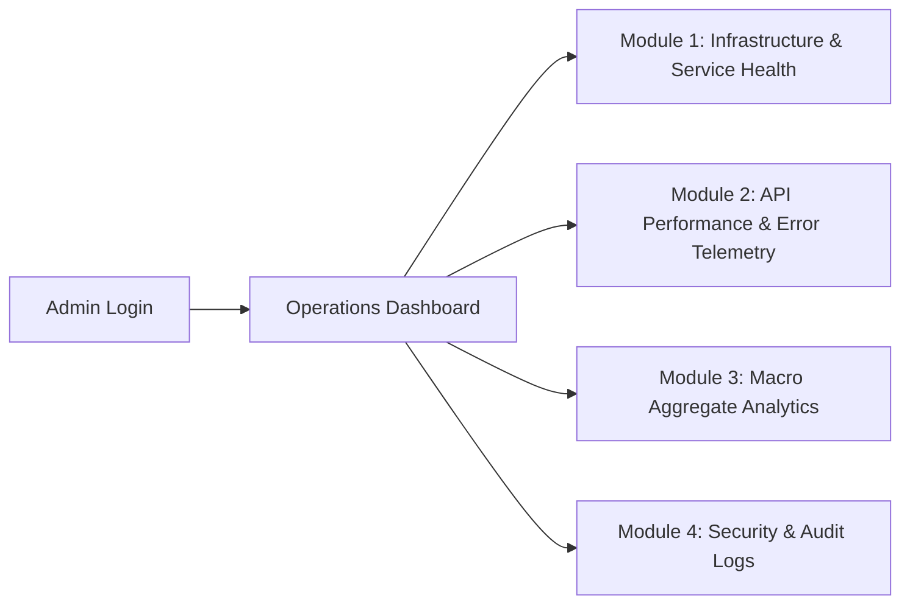

# ADMIN_DASHBOARD.md — Technical Monitoring Dashboard Specification (Zero-PHI Operations)

> **Tech Stack:** React 18, Vite, Tailwind CSS, Lucide React, Recharts  
> **Target Subsystem:** Phase 9 Operations & Maintenance Portal  
> **Privacy Classification:** Strictly Non-PHI / Aggregated Telemetry Only

---

## 1. Core Purpose & Architectural Privacy Boundaries

The VitaTrack Admin Dashboard is strictly an **engineering operations and infrastructure monitoring tool**. It provides DevOps and system administrators with technical visibility into backend health, API latency, crash telemetry, and macro-level application engagement.

```mermaid
graph TD
    subgraph Admin Web Application [React 18 + Tailwind CSS]
        UI1[Uptime & Ping Latency Cards]
        UI2[HTTP Error Breakdown & Stack Traces]
        UI3[Database Connection Pool Monitor]
        UI4[Aggregate Population Counters: DAU, MAU, Total Users]
        UI5[System Health Alert Bell]
    end

    subgraph Strictly Prohibited Data Views [Zero-PHI Invariants]
        BAD1[Patient Names & Email Lists]
        BAD2[Individual Symptom Ratings: Fatigue, Bone Pain]
        BAD3[Personal Risk Scores & Tier Classifications]
        BAD4[Clinician PDF Health Reports]
        BAD5[Patient Heart Rate, SpO2 & Sleep Streams]
    end

    Admin Web Application -.->|ARCHITECTURALLY BLOCKED| Strictly Prohibited Data Views

    style Admin Web Application fill:#e6f7ff,stroke:#1890ff,stroke-width:2px
    style Strictly Prohibited Data Views fill:#fff1f0,stroke:#f5222d,stroke-width:2px
```

> [!CAUTION]
> **Zero-PHI Guarantee:**  
> The admin portal has no database connections, API routes, or UI views capable of inspecting an individual user's medical history, assessment questionnaires, risk scores, or wearable biometrics. Any engineer or AI agent attempting to add patient-level lookup features violates core architecture rules.

---

## 2. Dashboard Modules & Screen Hierarchy



### 2.1 Module 1: Infrastructure & Service Health
- **Live Status Badges:** Backend API (Online/Degraded), MongoDB Replica Set (Connected), Redis Cache (Active), AI Proxy Service (Healthy).
- **System Resource Visualizers:**
  - CPU Utilization percentage over past 24 hours.
  - Node.js heap memory usage (MB) vs RSS memory.
  - Active Mongoose connection pool utilization (e.g. 14 / 50 connections).
- **Uptime Counter:** Continuous uptime timer (e.g. `99.98% over last 30 days`).

### 2.2 Module 2: API Performance & Error Telemetry
- **Latency Distribution:** 50th, 95th, and 99th percentile response times (Target: $P95 \le 300\text{ ms}$).
- **HTTP Status Code Breakdown:** Real-time donut chart displaying ratio of 2xx, 3xx, 4xx, and 5xx responses.
- **Scrubbed Error Stream:** Real-time log table showing timestamp, HTTP method, route (e.g., `POST /api/v1/assessments`), status code (`500`), error message, and sanitised stack trace. All request bodies are scrubbed before display.

### 2.3 Module 3: Macro Aggregate Analytics ($N \ge 10$)
- **Population Metrics:**
  - Total Registered Users (count).
  - Daily Active Users (DAU) & Monthly Active Users (MAU).
  - Total Completed Self-Assessments.
- **Population Distribution (Aggregated Percentage Only):**
  - High-level distribution: % Low Risk vs % Moderate Risk vs % High Risk across total population (no user links).
  - Wearable adoption rate: % of active users with Health Connect enabled.

### 2.4 Module 4: Administrative Security & Audit Logs
- **Audit Ledger:** Displays all admin sessions, authentication events, IP addresses, and configuration changes.

---

## 3. UI/UX Wireframe & Component Layout

```text
+--------------------------------------------------------------------------------------------------+
|  VitaTrack Operations Portal            [Env: Production]              Admin: sysadmin@vitatrack  |
+--------------------------------------------------------------------------------------------------+
|  [Dashboard]   [API Metrics]   [Error Logs]   [Audit Trail]   [Settings]              [Logout]   |
+--------------------------------------------------------------------------------------------------+
|                                                                                                  |
|  +---------------------+  +---------------------+  +---------------------+  +------------------+  |
|  | Backend Health      |  | API Avg Latency     |  | Total Users (Macro) |  | 5xx Error Rate   |  |
|  | [🟢 OPERATIONAL]    |  | 58 ms (P95: 142ms)  |  | 2,410 Registered    |  | 0.02% (Healthy)  |  |
|  | Uptime: 99.98%      |  | Total Req: 184.2k   |  | DAU: 480 | MAU: 1.8k|  | 3 events in 24h  |  |
|  +---------------------+  +---------------------+  +---------------------+  +------------------+  |
|                                                                                                  |
|  +------------------------------------------------+  +-----------------------------------------+  |
|  | API Request Volume & Latency Trend (24h)       |  | Aggregate Assessment Distribution       |  |
|  | [ ~~~~ Line Chart: Req/sec and Latency ~~~~ ]  |  | [ (O) Donut Chart: Low 45% | Mod 38% ]  |  |
|  |                                                |  |                    [ High 17% ]         |  |
|  +------------------------------------------------+  +-----------------------------------------+  |
|                                                                                                  |
|  +---------------------------------------------------------------------------------------------+  |
|  | Real-Time Technical Error Log (Sanitized - Zero PHI)                                         |  |
|  | TIME          | METHOD | ROUTE                      | STATUS | ERROR MESSAGE                 |  |
|  | 17:14:02 UTC  | POST   | /api/v1/assessments        | 500    | Database connection timeout   |  |
|  | 17:02:11 UTC  | POST   | /api/v1/auth/login         | 429    | Rate limit exceeded: 5 tries  |  |
|  +---------------------------------------------------------------------------------------------+  |
+--------------------------------------------------------------------------------------------------+
```

---

## 4. Role-Based Access Control (RBAC)

| Role | Permissions | Forbidden Capabilities |
|:---|:---|:---|
| **DevOps Admin** | View server health, latency, database connection pools, reboot microservices, adjust rate limits | Viewing patient profiles, accessing individual assessment records, querying clinical database collections |
| **Support Auditor** | Inspect sanitized error traces, verify email delivery status, inspect audit logs | Viewing passwords, reading user messages, decrypting biometric feeds |
| **Patient User** | Access own profile, submit self-assessments, view own history & reports | Accessing any `/api/v1/admin/*` routes (rejected with 403 Forbidden) |

---

## 5. Security & Verification Tests for Admin Zero-PHI Invariant

The test suite must include an automated regression test confirming that admin responses do not leak sensitive fields:

```typescript
// Architectural Invariant Test (Planned Phase 9)
test('Admin metrics API must never return patient health fields', async () => {
  const adminToken = await getAdminAuthToken();
  const res = await request(app)
    .get('/api/v1/admin/metrics')
    .set('Authorization', `Bearer ${adminToken}`);

  expect(res.status).toBe(200);
  const rawBody = JSON.stringify(res.body);

  // Assert absence of sensitive clinical keywords
  expect(rawBody).not.toMatch(/fatigue/i);
  expect(rawBody).not.toMatch(/bonePain/i);
  expect(rawBody).not.toMatch(/patientName/i);
  expect(rawBody).not.toMatch(/spO2/i);
  expect(rawBody).not.toMatch(/symptomScore/i);
});
```
