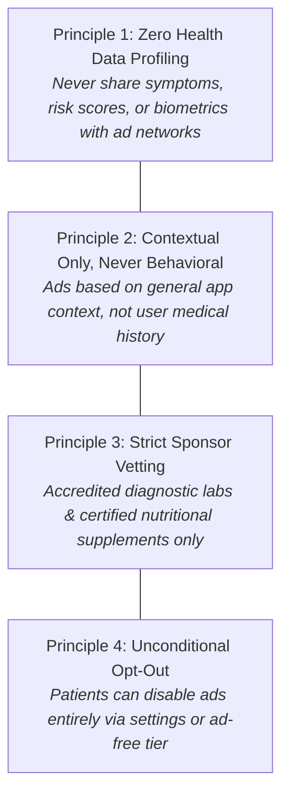
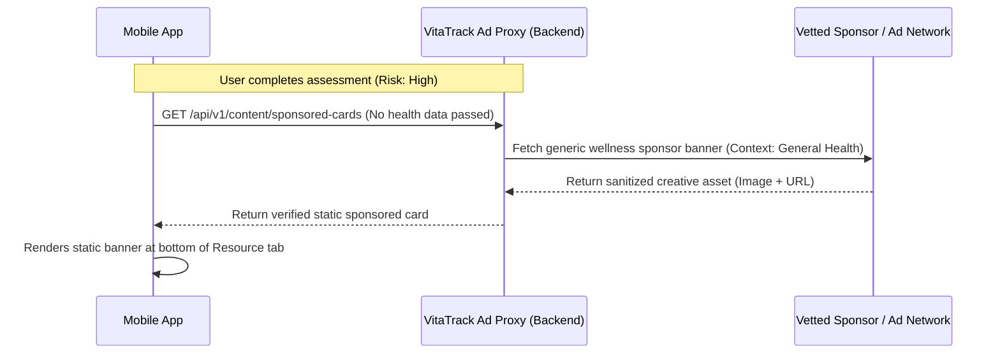

# ADVERTISING_PLAN.md — Future Ethical & Privacy-Preserving Monetization Strategy

> **Status:** **FUTURE DEFERRED PHASE ONLY — STRICTLY UNIMPLEMENTED**  
> **Rule:** No advertising code, SDKs (AdMob, Meta Ads), or tracking dependencies may be installed or implemented during Phases 0 through 10. Implementation requires explicit written user authorization.

---

## 1. Ethical Foundations for Healthcare Advertising

Monetization within health applications presents sensitive ethical and regulatory challenges. Misleading claims, predatory supplement advertising, or surveillance-based targeting undermine patient trust and violate data protection mandates (DPDP Act 2023, GDPR, HIPAA principles).

VitaTrack adheres to four foundational ethical advertising principles:

---

## 2. Inviolable Privacy Safeguards

1. **Absolute Firewall between Clinical Data and Ad SDKs:**
   - Ad SDKs (if introduced in future phases) will **never** receive user identifiers, age, gender, symptom logs, risk scores, or wearable biometrics.
   - Request payloads dispatched to ad servers will contain solely coarse device information (OS version, general screen size) with advertising ID tracking disabled.
2. **No Intrusive Formats:**
   - **Prohibited:** Interstitial popups, blocking modal ads during self-assessments, countdown video ads, or auto-playing audio ads.
   - **Allowed (Future):** Static, clearly labeled sponsored cards positioned cleanly at the bottom of the Recommendations tab or Resource Hub.
3. **Transparent Sponsoring Labels:**
   - Any sponsored content must carry a high-contrast label: `[SPONSORED / ADVERTISEMENT]` alongside a disclaimer: *"VitaTrack does not endorse any specific brand. Consult your physician before taking supplements."*

---

## 3. Permissible vs. Prohibited Advertising Categories

| Permissible Categories (Subject to Vetting) | Strictly Prohibited Categories |
|:---|:---|
| **Accredited Diagnostic Pathology Labs:** Prompts to book clinical 25(OH)D venous blood serum tests at certified medical labs. | **Unregulated "Miracle" Supplements:** Uncertified herbal extracts or unverified high-dose Vitamin D claims. |
| **Certified Nutritional Products:** FSSAI / FDA approved Vitamin D fortified foods and third-party certified supplements. | **Prescription Pharmaceuticals:** Regulated prescription medications or hormonal therapies. |
| **Dermatological Sun Protection:** Broad-spectrum SPF 30+ sunscreens for post-synthesis solar protection. | **Predatory Lending & Financial Services:** Payday loans or predatory medical insurance. |
| **Ergonomic & Fitness Equipment:** Resistance bands and walking shoes promoting weight-bearing bone health. | **Behavioral Retargeting Trackers:** Facebook Pixel, Google Tag Manager tracking health actions. |

---

## 4. Proposed Technical Architecture (When Authorized)

When the user explicitly authorizes implementation of this deferred phase, the architecture will utilize a privacy-preserving proxy layer:

- **Backend Ad Mediation:** Rather than embedding third-party SDKs that harvest location and device identifiers on the client, ads are fetched via a backend proxy that acts as an anonymization shield.
- **Client Opt-Out Toggle:** A simple setting in `Settings -> Privacy & Preferences -> Show Sponsored Health Resources [Toggle On/Off]`.

---

## 5. Alternative Sustainable Funding Models

To eliminate the need for advertising entirely, the platform may explore alternative sustainable models:
- **Institutional & Research Grants:** Supported by university research initiatives (e.g. VGU Jaipur academic grants).
- **Freemium Clinician Export Tier:** Basic self-assessment and recommendations remain 100% free; specialized clinic integration or automated EHR export offered as an institutional subscription.
- **Non-Profit Healthcare Partnerships:** Partnering with public health departments to provide preventive screening tools in underserved rural communities.
