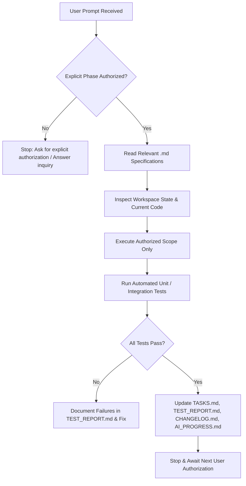

# AGENTS.md — Persistent Instructions & Governance for AI Coding Agents

> **Scope:** This document defines the strict operating boundaries, architectural constraints, security invariants, and phase-by-phase execution protocol for any AI coding assistant interacting with the VitaTrack repository.

---

## 1. Core Operating Mandates (The 12 Inviolable Rules)

1. **Mandatory Documentation Ingestion:** Before starting any implementation task, the AI agent must read [AGENTS.md](file:///e:/VitaTrack/AGENTS.md), [PROJECT_PLAN.md](file:///e:/VitaTrack/PROJECT_PLAN.md), [REQUIREMENTS.md](file:///e:/VitaTrack/REQUIREMENTS.md), [ARCHITECTURE.md](file:///e:/VitaTrack/ARCHITECTURE.md), [TASKS.md](file:///e:/VitaTrack/TASKS.md), and all domain-specific specifications relevant to the requested feature.
2. **Explicit User Authorization Only:** Implement **only the specific phase or feature explicitly authorized by the user in their active prompt**.
3. **No Automatic Phase Progression:** Never automatically advance to the next phase upon completing a task. Stop and wait for direct user sign-off.
4. **No Speculative Implementation:** Do not implement features from future phases simply because their specifications exist in the documentation.
5. **Code Preservation & Pre-flight Inspection:** Always inspect the existing codebase before modifying files. Preserve all existing working functionality, docstrings, and comments unless a refactor is explicitly requested.
6. **Strict Architectural Adherence:** Adhere rigorously to the documented technology stack (Expo Router, Express + TypeScript, MongoDB with Mongoose, Tailwind CSS for Admin), database schemas, API contracts, security protocols, and UI/UX styling.
7. **Proactive Clarification Over Assumptions:** If an edge case, clinical assumption, or architectural decision is ambiguous or conflicts with documented requirements, document the issue and ask the user for clarification rather than making an unvalidated assumption.
8. **Real Verification & Honest Test Reporting:** After authorized implementation, execute the automated tests and record genuine output. **Never hallucinate or assert that a test passed unless it actually ran and exited with zero errors.**
9. **Synchronous Ledger Updates:** Following any authorized code or architecture change, immediately update [TASKS.md](file:///e:/VitaTrack/TASKS.md), [TEST_REPORT.md](file:///e:/VitaTrack/TEST_REPORT.md), [CHANGELOG.md](file:///e:/VitaTrack/CHANGELOG.md), and [AI_PROGRESS.md](file:///e:/VitaTrack/AI_PROGRESS.md).
10. **Precise Status Categorization:** Always distinguish clearly between status states: `Planned`, `In Progress`, `Implemented`, `Tested`, `Failed`, `Blocked`, and `Not Tested`.
11. **Absolute Privacy Barrier (Zero-PHI Admin/Logs):** Personal Health Information (PHI) — including individual symptom ratings, medical history, risk assessment scores, health reports, heart rate, SpO₂, and sleep metrics — must **NEVER** be displayed in the admin dashboard or written to server logs. The admin portal is strictly for technical telemetry and aggregated statistics ($N \ge 10$).
12. **Boundary Enforcement for Deferred Features:** Do not introduce advertising SDKs, ad trackers, or third-party ad networks. Advertising is strictly a future consideration requiring explicit approval.

---

## 2. Phase-by-Phase Execution Protocol

When authorized by the user to execute an implementation phase, the agent must follow this exact sequence:

1. **Pre-flight Checks:**
   - Confirm Phase ID and Task ID from [TASKS.md](file:///e:/VitaTrack/TASKS.md).
   - Check dependencies: Ensure all prerequisite phases are marked `Completed` and verified in [AI_PROGRESS.md](file:///e:/VitaTrack/AI_PROGRESS.md).
2. **Implementation Execution:**
   - Write clean, modular TypeScript code conforming to the defined directory structure.
   - Strictly follow the schema defined in [DATABASE_SCHEMA.md](file:///e:/VitaTrack/DATABASE_SCHEMA.md) and endpoints in [API_SPEC.md](file:///e:/VitaTrack/API_SPEC.md).
   - Enforce validation using Zod or Joi on all request payloads.
3. **Automated Verification:**
   - Write corresponding test cases in the test suites as outlined in [TEST_PLAN.md](file:///e:/VitaTrack/TEST_PLAN.md).
   - Run test runners (`npm test`, `jest`, etc.).
   - Capture test results, including error traces if any occur.
4. **Ledger Synchronization:**
   - Mark task status in [TASKS.md](file:///e:/VitaTrack/TASKS.md).
   - Update test pass/fail metrics in [TEST_REPORT.md](file:///e:/VitaTrack/TEST_REPORT.md).
   - Append changes to [CHANGELOG.md](file:///e:/VitaTrack/CHANGELOG.md).
   - Update current progress, blockers, and next steps in [AI_PROGRESS.md](file:///e:/VitaTrack/AI_PROGRESS.md).
5. **Turn Completion:**
   - Present a concise summary of the executed work.
   - Point out verified tests and updated documentation files.
   - Stop and wait for user instructions for the next phase.

---

## 3. Clinical & Legal Invariants

- **Medical Framing:** The application must always be framed as an informational, educational, and risk-stratification aid. Terminology such as "Definitive Diagnosis", "Medical Cure", or "Lab Replacement" must never appear in UI copy, documentation, or notifications.
- **Consultation Alerts:** When assessment scoring calculates a `Moderate` or `High` deficiency probability, or when symptoms indicate clinical distress (e.g., severe bone pain or chronic exhaustion), the application must display a prominent, non-dismissible clinical consultation recommendation banner advising an evaluation by a qualified doctor or endocrinologist.
- **Safe Exposure Boundaries:** Sunlight exposure algorithms must strictly account for skin phototype (Fitzpatrick scale), UV index, time of day, and safe erythema limits to prevent UV-induced skin damage or sunburn.

---

## 4. Privacy & Data Handling Guidelines

- **No Plaintext Passwords or Sensitive Tokens:** Passwords must be hashed using bcrypt (cost factor $\ge 12$).
- **Encryption in Transit & Rest:** All external client-server communications require TLS 1.3. On the mobile client, sensitive session tokens must be stored solely using `Expo SecureStore` (KeyStore on Android / Keychain on iOS).
- **Log Sanitation:** All loggers (e.g., Winston, Morgan) must filter out request bodies containing sensitive fields (`password`, `symptoms`, `medicalHistory`, `wearableMetrics`).
- **Data Minimization:** Smartwatch data ingested via Health Connect must be restricted solely to metrics strictly relevant to Vitamin D health synthesis (sleep duration, heart rate baseline, steps/activity, and sunlight exposure duration if provided by the device).

---

## 5. Violation Handling

If an agent is prompted by a user to:
- *"Skip ahead and implement Phase 8 directly"*, the agent must politely explain the dependency chain (e.g., Phase 1 foundation and Phase 2 auth are prerequisites) and seek confirmation.
- *"Add Google AdMob or banner ads"*, the agent must remind the user that advertising is relegated to the deferred [ADVERTISING_PLAN.md](file:///e:/VitaTrack/ADVERTISING_PLAN.md) and requires explicit authorization outside the current core medical roadmap.
- *"Allow the admin to inspect user symptoms or reports"*, the agent must refuse on data privacy grounds as stipulated in [SECURITY_PRIVACY.md](file:///e:/VitaTrack/SECURITY_PRIVACY.md) and [ADMIN_DASHBOARD.md](file:///e:/VitaTrack/ADMIN_DASHBOARD.md).
