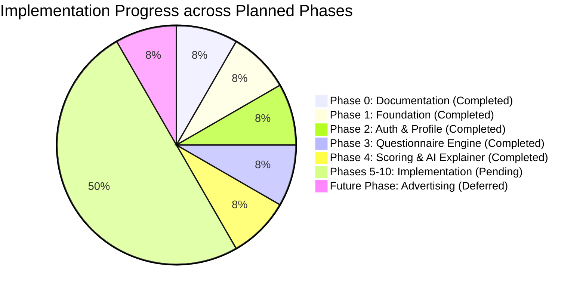

# AI_PROGRESS.md — AI Agent Execution State & Phase Tracking Ledger

> **Platform:** VitaTrack — Self-Diagnosis & Guidance Platform for Vitamin D Deficiency  
> **Last Synchronized:** 2026-10-17 17:28:30 UTC  
> **Operating Agent:** Antigravity AI Assistant

---

## 1. Current Phase & High-Level Execution Status

| Metric | Status Value |
|:---|:---|
| **Current Active Phase** | **Phase 4: Deterministic Risk Scoring & AI Explainer Engine** |
| **Phase 4 Status** | **100% COMPLETE & VERIFIED** |
| **Application Source Code Status** | **Phases 1, 2, 3 & 4 Implemented (Monorepo, Auth, Profile, Assessment Questionnaire, Deterministic Scoring Sub-Engine, AI Explainer Proxy, Mobile Results Screen with SVG Gauge & Clinical Alerts)** |
| **Tests Executed** | **66 Passed (Jest Unit & Supertest Integration: 100% pass rate, Mobile TypeScript check clean)** |
| **Next Authorized Phase** | **Phase 5: Personalized Nutritional, Solar & Exercise Guidance (Awaiting User Command)** |
| **Active Blockers** | **None (Standing by for user instruction to begin Phase 5)** |

---

## 2. Phase-by-Phase Progress Ledger

| Phase ID | Description | Specification Status | Implementation Status | Test Status | Next Action |
|:---:|:---|:---:|:---:|:---:|:---|
| **Phase 0** | Requirements & Documentation System | ✅ Completed | N/A (Docs Only) | Verified | Freeze Phase 0 docs |
| **Phase 1** | Foundation & Tooling Setup | ✅ Specified | ✅ `Completed` | ✅ **Passed (6/6)** | Verified & Frozen |
| **Phase 2** | Auth, Security Vault & Profile | ✅ Specified | ✅ `Completed` | ✅ **Passed (24/24)**| Verified & Frozen |
| **Phase 3** | Clinical Questionnaire Engine | ✅ Specified | ✅ `Completed` | ✅ **Passed (30/30)**| Verified & Frozen |
| **Phase 4** | Risk Scoring & AI Explainer Engine | ✅ Specified | ✅ `Completed` | ✅ **Passed (66/66)**| Verified & Frozen |
| **Phase 5** | Personalized Guidance (Diet, Sun, Exercise) | ✅ Specified | ⏳ `Planned` | `Pending` | Prerequisite: Phase 4 complete |
| **Phase 6** | Progress History & Clinician PDF Reports | ✅ Specified | ⏳ `Planned` | `Pending` | Prerequisite: Phase 5 |
| **Phase 7** | Reminders & Push Notification System | ✅ Specified | ⏳ `Planned` | `Pending` | Prerequisite: Phase 6 |
| **Phase 8** | Smartwatch Sync (Android Health Connect) | ✅ Specified | ⏳ `Planned` | `Pending` | Prerequisite: Phase 7 |
| **Phase 9** | Admin Operations Dashboard (Zero-PHI) | ✅ Specified | ⏳ `Planned` | `Pending` | Prerequisite: Phase 8 |
| **Phase 10**| Hardening, Security Audit & EAS Release | ✅ Specified | ⏳ `Planned` | `Pending` | Prerequisite: Phase 9 |
| **Future** | Ethical Contextual Advertising System | ✅ Specified | 🛑 `Deferred` | `Pending` | Explicit Authorization Only |

---

## 3. Phase 0 Deliverables Audit (All 20 Required Files)

All 20 mandatory Markdown documentation files are maintained with full cross-referencing and architectural consistency (`README.md` at project root, and 19 specifications in `docs/`):

- [x] [README.md](file:///e:/VitaTrack/README.md) — Comprehensive overview, VGU academic attribution, and 20-file navigation index.
- [x] [docs/AGENTS.md](file:///e:/VitaTrack/docs/AGENTS.md) — Persistent operating mandates, the 12 inviolable agent rules, and execution protocol.
- [x] [docs/PROJECT_PLAN.md](file:///e:/VitaTrack/docs/PROJECT_PLAN.md) — Detailed multi-phase roadmap, entry/exit criteria, and risk matrix.
- [x] [docs/REQUIREMENTS.md](file:///e:/VitaTrack/docs/REQUIREMENTS.md) — Traceability matrix mapping PPT slides to formal FRs and NFRs.
- [x] [docs/ARCHITECTURE.md](file:///e:/VitaTrack/docs/ARCHITECTURE.md) — System C4 diagrams, container models, two-tier risk engine, and Zero-PHI boundary.
- [x] [docs/TASKS.md](file:///e:/VitaTrack/docs/TASKS.md) — Ordered, numbered implementation task backlog covering Phases 0 through 10.
- [x] [docs/TEST_PLAN.md](file:///e:/VitaTrack/docs/TEST_PLAN.md) — Multi-tier QA test strategy, test suites, and master test case inventory.
- [x] [docs/TEST_REPORT.md](file:///e:/VitaTrack/docs/TEST_REPORT.md) — Quality ledger recording Phase 1 & 2 passed tests and pending future cases.
- [x] [docs/API_SPEC.md](file:///e:/VitaTrack/docs/API_SPEC.md) — Complete OpenAPI 3.0 REST endpoints, request/response models, and status codes.
- [x] [docs/DATABASE_SCHEMA.md](file:///e:/VitaTrack/docs/DATABASE_SCHEMA.md) — MongoDB collections, Mongoose models, compound/TTL indexes, and ER diagram.
- [x] [docs/SECURITY_PRIVACY.md](file:///e:/VitaTrack/docs/SECURITY_PRIVACY.md) — Zero-PHI firewall, token rotation, bcrypt, and DPDP/HIPAA alignment.
- [x] [docs/SMARTWATCH_INTEGRATION.md](file:///e:/VitaTrack/docs/SMARTWATCH_INTEGRATION.md) — Android Health Connect architecture, supported metrics, and normalizers.
- [x] [docs/DEVICE_COMPATIBILITY.md](file:///e:/VitaTrack/docs/DEVICE_COMPATIBILITY.md) — Android OS version matrix, manufacturer ecosystem tiers, and sensor fallbacks.
- [x] [docs/ADMIN_DASHBOARD.md](file:///e:/VitaTrack/docs/ADMIN_DASHBOARD.md) — Technical operations portal specs, wireframes, and Zero-PHI safeguards ($N \ge 10$).
- [x] [docs/ADVERTISING_PLAN.md](file:///e:/VitaTrack/docs/ADVERTISING_PLAN.md) — Future ethical monetization plan (strictly deferred and unimplemented).
- [x] [docs/UI_UX_SPEC.md](file:///e:/VitaTrack/docs/UI_UX_SPEC.md) — Amber/slate design system, screen catalog, wireflows, and micro-interactions.
- [x] [docs/DEPLOYMENT.md](file:///e:/VitaTrack/docs/DEPLOYMENT.md) — Expo EAS Android build pipeline, Docker containerization, and CI/CD workflows.
- [x] [docs/CHANGELOG.md](file:///e:/VitaTrack/docs/CHANGELOG.md) — Version history and release notes.
- [x] [docs/DECISIONS.md](file:///e:/VitaTrack/docs/DECISIONS.md) — Architecture Decision Records (ADR-001 through ADR-009).
- [x] [docs/AI_PROGRESS.md](file:///e:/VitaTrack/docs/AI_PROGRESS.md) — Real-time execution tracking ledger.

---

## 4. Immediate Next Actions
 
1. Present verified completion of Phase 2 to the user.
2. Maintain strict stop condition: **Do not write Phase 3 clinical questionnaire application code.**
3. Await explicit user prompt and authorization before proceeding to **Phase 3: Clinical Questionnaire Engine**.
