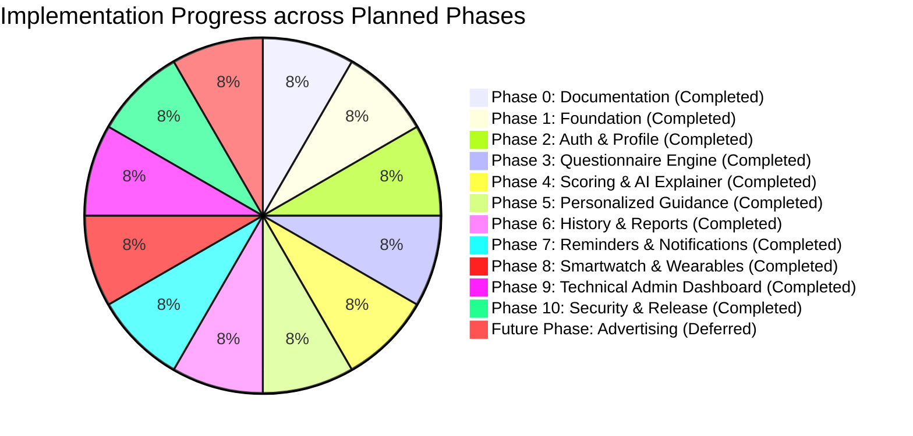

# AI_PROGRESS.md — AI Agent Execution State & Phase Tracking Ledger

> **Platform:** VitaTrack — Self-Diagnosis & Guidance Platform for Vitamin D Deficiency  
> **Last Synchronized:** 2026-10-18 08:50:00 UTC  
> **Operating Agent:** Antigravity AI Assistant

---

## 1. Current Phase & High-Level Execution Status

| Metric | Status Value |
|:---|:---|
| **Current Active Phase** | **Phase 10: Security Hardening, E2E Testing & EAS Android Release** |
| **Phase 10 Status** | **100% COMPLETE & VERIFIED (v1.0.0 Production Release Tagged)** |
| **Application Source Code Status** | **All Core Roadmap Phases Complete: Monorepo Foundation, Secure Auth & Profile, Clinical Questionnaire Engine, Deterministic Risk Scoring & AI Explainer, Nutrition/Solar/Exercise Guidance Hub, Longitudinal Trend Analytics & Clinician PDF Reports, Context-Aware Local Reminders Scheduler, Android Health Connect Biometric Ingestion & Fatigue Correlation Hub, Technical Operations Web Portal with Zero-PHI Invariant, Security Hardening (Rate Limiting, Helmet Headers, NoSQL Sanitizer), Comprehensive E2E Journey Suite, and EAS Android Build & Keystore Configuration.** |
| **Tests Executed** | **146 Passed (17 Jest Test Suites: 100% pass rate, 4 Maestro UI automated flow specs, Admin SPA build clean, Mobile TypeScript check clean, Backend production build clean)** |
| **Next Authorized Phase** | **Core Medical Roadmap Complete. Standing by for user instructions or future deployment commands.** |
| **Active Blockers** | **None (Platform production hardened, verified, and release tagged at v1.0.0)** |

---

## 2. Phase-by-Phase Progress Ledger

| Phase ID | Description | Specification Status | Implementation Status | Test Status | Next Action |
|:---:|:---|:---:|:---:|:---:|:---|
| **Phase 0** | Requirements & Documentation System | ✅ Completed | N/A (Docs Only) | Verified | Freeze Phase 0 docs |
| **Phase 1** | Foundation & Tooling Setup | ✅ Specified | ✅ `Completed` | ✅ **Passed (6/6)** | Verified & Frozen |
| **Phase 2** | Auth, Security Vault & Profile | ✅ Specified | ✅ `Completed` | ✅ **Passed (24/24)**| Verified & Frozen |
| **Phase 3** | Clinical Questionnaire Engine | ✅ Specified | ✅ `Completed` | ✅ **Passed (30/30)**| Verified & Frozen |
| **Phase 4** | Risk Scoring & AI Explainer Engine | ✅ Specified | ✅ `Completed` | ✅ **Passed (66/66)**| Verified & Frozen |
| **Phase 5** | Personalized Guidance (Diet, Sun, Exercise) | ✅ Specified | ✅ `Completed` | ✅ **Passed (83/83)**| Verified & Frozen |
| **Phase 6** | Progress History & Clinician PDF Reports | ✅ Specified | ✅ `Completed` | ✅ **Passed (86/86)**| Verified & Frozen |
| **Phase 7** | Reminders & Push Notification System | ✅ Specified | ✅ `Completed` | ✅ **Passed (96/96)**| Verified & Frozen |
| **Phase 8** | Smartwatch Sync (Android Health Connect) | ✅ Specified | ✅ `Completed` | ✅ **Passed (117/117)**| Verified & Frozen |
| **Phase 9** | Admin Operations Dashboard (Zero-PHI) | ✅ Specified | ✅ `Completed` | ✅ **Passed (126/126)**| Verified & Frozen |
| **Phase 10**| Hardening, Security Audit & EAS Release | ✅ Specified | ✅ `Completed` | ✅ **Passed (146/146)**| Verified & Frozen (v1.0.0) |
| **Future** | Ethical Contextual Advertising System | ✅ Specified | 🛑 `Deferred` | `Pending` | Explicit Authorization Only |

---

## 3. Phase 0 Deliverables Audit (All 20 Required Files)

All 20 mandatory Markdown documentation files are maintained with full cross-referencing and architectural consistency (`README.md` at project root, and 19 specifications in `docs/`):

- [x] [README.md](file:///e:/VitaTrack/README.md) — Comprehensive overview, VGU academic attribution, and 20-file navigation index.
- [x] [docs/AGENTS.md](file:///e:/VitaTrack/docs/AGENTS.md) — Persistent operating mandates, the 12 inviolable agent rules, and execution protocol.
- [x] [docs/PROJECT_PLAN.md](file:///e:/VitaTrack/docs/PROJECT_PLAN.md) — Detailed multi-phase roadmap, entry/exit criteria, and risk matrix.
- [x] [docs/REQUIREMENTS.md](file:///e:/VitaTrack/docs/REQUIREMENTS.md) — Traceability matrix mapping PPT slides to formal FRs and NFRs.
- [x] [docs/ARCHITECTURE.md](file:///e:/VitaTrack/docs/ARCHITECTURE.md) — System C4 diagrams, container models, two-tier risk engine, and Zero-PHI boundary.
- [x] [docs/TASKS.md](file:///e:/VitaTrack/docs/TASKS.md) — Ordered, numbered implementation task backlog covering Phases 0 through 10.
- [x] [docs/TEST_PLAN.md](file:///e:/VitaTrack/docs/TEST_PLAN.md) — Multi-tier QA test strategy, test suites, and master test case inventory.
- [x] [docs/TEST_REPORT.md](file:///e:/VitaTrack/docs/TEST_REPORT.md) — Quality ledger recording Phase 1 through 10 passed tests and metrics.
- [x] [docs/API_SPEC.md](file:///e:/VitaTrack/docs/API_SPEC.md) — Complete OpenAPI 3.0 REST endpoints, request/response models, and status codes.
- [x] [docs/DATABASE_SCHEMA.md](file:///e:/VitaTrack/docs/DATABASE_SCHEMA.md) — MongoDB collections, Mongoose models, compound/TTL indexes, and ER diagram.
- [x] [docs/SECURITY_PRIVACY.md](file:///e:/VitaTrack/docs/SECURITY_PRIVACY.md) — Zero-PHI firewall, token rotation, bcrypt, and DPDP/HIPAA alignment.
- [x] [docs/SMARTWATCH_INTEGRATION.md](file:///e:/VitaTrack/docs/SMARTWATCH_INTEGRATION.md) — Android Health Connect architecture, supported metrics, and normalizers.
- [x] [docs/DEVICE_COMPATIBILITY.md](file:///e:/VitaTrack/docs/DEVICE_COMPATIBILITY.md) — Android OS version matrix, manufacturer ecosystem tiers, and sensor fallbacks.
- [x] [docs/ADMIN_DASHBOARD.md](file:///e:/VitaTrack/docs/ADMIN_DASHBOARD.md) — Technical operations portal specs, wireframes, and Zero-PHI safeguards ($N \ge 10$).
- [x] [docs/ADVERTISING_PLAN.md](file:///e:/VitaTrack/docs/ADVERTISING_PLAN.md) — Future ethical monetization plan (strictly deferred and unimplemented).
- [x] [docs/UI_UX_SPEC.md](file:///e:/VitaTrack/docs/UI_UX_SPEC.md) — Amber/slate design system, screen catalog, wireflows, and micro-interactions.
- [x] [docs/DEPLOYMENT.md](file:///e:/VitaTrack/docs/DEPLOYMENT.md) — Expo EAS Android build pipeline, Docker containerization, and CI/CD workflows.
- [x] [docs/CHANGELOG.md](file:///e:/VitaTrack/docs/CHANGELOG.md) — Version history and release notes.
- [x] [docs/DECISIONS.md](file:///e:/VitaTrack/docs/DECISIONS.md) — Architecture Decision Records (ADR-001 through ADR-012).
- [x] [docs/HUMAN_UI_GUEST_REVAMP_SPEC.md](file:///e:/VitaTrack/docs/HUMAN_UI_GUEST_REVAMP_SPEC.md) — Mobile UI/UX Human Stylist, Guest Mode Zero-DB, Bottom Navbar, and Redis/Load Balancing Architecture.
- [x] [docs/AI_PROGRESS.md](file:///e:/VitaTrack/docs/AI_PROGRESS.md) — Real-time execution tracking ledger.

---

## 4. Current Platform Milestone

1. **Phase 10 (Security Hardening, E2E Testing & EAS Android Release) is 100% Complete & Verified.**
2. All 10 core roadmap implementation phases (Phases 1 through 10) are completed with 146 passed automated tests, clean static builds across all workspaces, and zero outstanding errors.
3. The platform release has been formally tagged as `v1.0.0`.
4. **Mobile UI/UX Human-Stylist Revamp & Architecture Specification Completed:**
   - [HUMAN_UI_GUEST_REVAMP_SPEC.md](file:///e:/VitaTrack/docs/HUMAN_UI_GUEST_REVAMP_SPEC.md), [UI_UX_SPEC.md](file:///e:/VitaTrack/docs/UI_UX_SPEC.md), [ARCHITECTURE.md](file:///e:/VitaTrack/docs/ARCHITECTURE.md), and [DECISIONS.md](file:///e:/VitaTrack/docs/DECISIONS.md) (ADR-010, ADR-011, ADR-012) fully documented and aligned.
   - Ready for user authorization to proceed with implementation.

