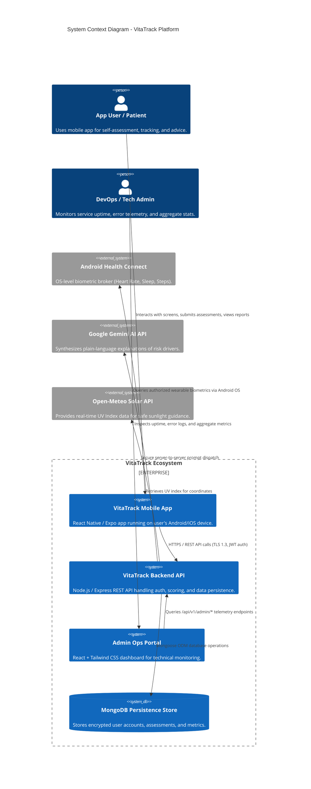
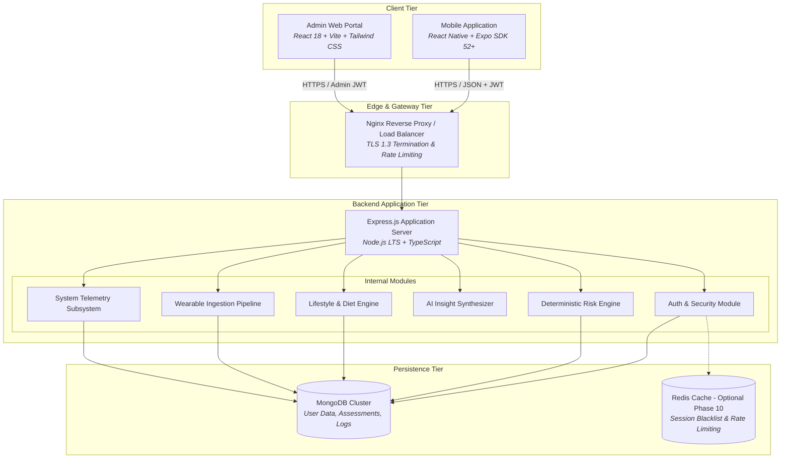
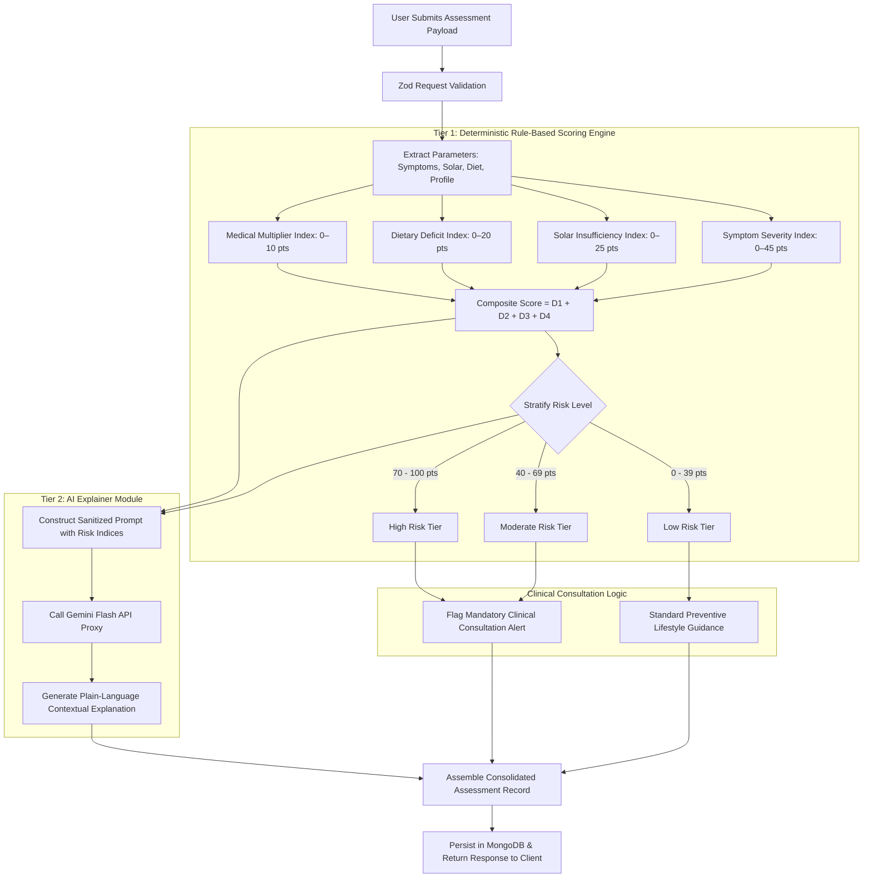
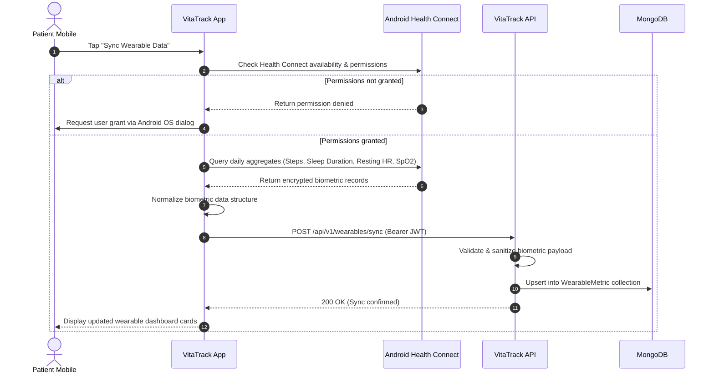
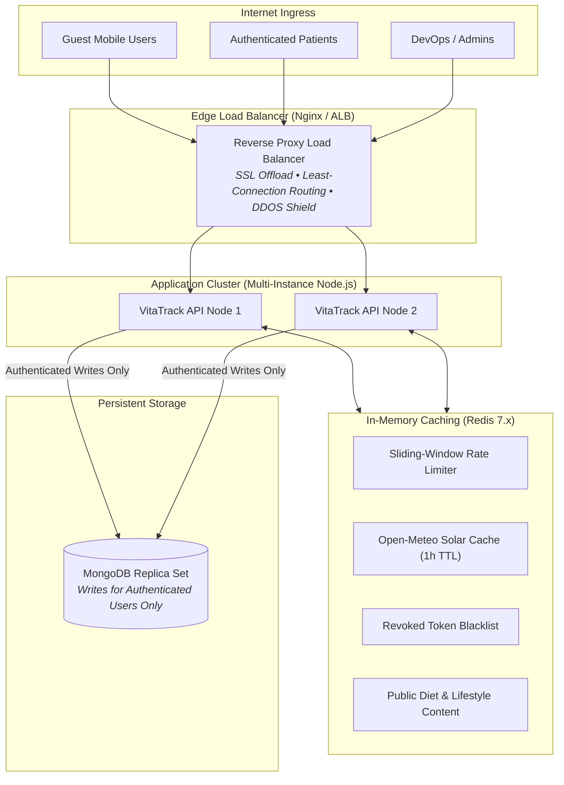

# ARCHITECTURE.md — System Architecture & Component Specifications

> **Project:** VitaTrack — Self-Diagnosis & Guidance Platform for Vitamin D Deficiency  
> **Status:** Specification Phase (Phase 0)

---

## 1. High-Level System Architecture

VitaTrack adopts a decoupled, multi-tier client-server architecture designed for high availability, clinical reliability, mobile offline resilience, and strict privacy boundaries.



---

## 2. Container Diagram (C4 Level 2)



---

## 3. Component Details & Responsibilities

### 3.1 Mobile Application (`apps/mobile`)
- **Framework:** React Native with Expo SDK and TypeScript.
- **Routing:** Expo Router (file-based navigation with typed routes).
- **State Management:** Zustand for lightweight, decoupled application state (auth token, user preferences, offline drafts).
- **Storage:**
  - `expo-secure-store` for sensitive JWT access and refresh tokens.
  - `@react-native-async-storage/async-storage` for non-sensitive cached UI state and draft assessment answers.
- **Hardware & Native Bridges:**
  - `react-native-health-connect` for querying Android Health Connect biometrics.
  - `expo-notifications` for scheduled local daily reminders (sunlight, meals, follow-ups).
  - `expo-print` & `expo-sharing` for client-side clinician-ready PDF generation.

### 3.2 Backend REST API (`apps/backend`)
- **Runtime:** Node.js (v20+ LTS) with Express and TypeScript.
- **Design Pattern:** Clean layered architecture:
  - `controllers/`: HTTP request parsing, status codes, and response formatting.
  - `services/`: Core business logic, scoring algorithms, and recommendation computations.
  - `models/`: Mongoose data schemas and database constraints.
  - `middlewares/`: JWT authentication, role verification, rate limiting, and log sanitization.
  - `validators/`: Zod payload validation schemas for incoming requests.
- **Documentation:** Swagger UI / OpenAPI 3.0 specification auto-served at `/api-docs`.

### 3.3 Database Layer (`apps/backend/src/models`)
- **Technology:** MongoDB 7.0+ with Mongoose ODM.
- **Key Schemas:** `User`, `Assessment`, `Recommendation`, `WearableMetric`, `ReminderSchedule`, `SystemMetric`, `AuditLog`.
- **Indexing Strategy:** Compound indexing on `(userId, createdAt)` for rapid history retrieval; TTL indexes for transient telemetry data.

### 3.4 Admin Dashboard (`apps/admin`)
- **Framework:** React 18 with Vite and Tailwind CSS.
- **Role:** Pure technical operations and maintenance.
- **Capabilities:** System uptime, API error logs, server resource monitoring, aggregate user counts.
- **Security Boundary:** Zero access to individual health records or patient-specific telemetry.

---

## 4. Comprehensive Feature-Based Project File Structure

VitaTrack strictly follows a **Feature-Based (Vertical Slice) Architecture** across both mobile and backend applications. Rather than grouping files purely by technical roles (e.g., placing all controllers, all models, or all components into single flat folders), code is encapsulated by **business domain features**. Each feature directory bundles its own routes, controllers, services, UI components, state stores, models, and tests.

```text
VitaTrack/
├── .github/
│   └── workflows/                 # CI/CD pipelines (test, lint, EAS build triggers)
├── apps/
│   ├── mobile/                    # React Native + Expo SDK 52+ Client
│   │   ├── app/                   # Expo Router File-Based Routing (Thin route entrypoints)
│   │   │   ├── _layout.tsx        # Root navigation stack & theme provider
│   │   │   ├── index.tsx          # Initial routing redirect (Auth vs Tabs)
│   │   │   ├── (auth)/            # Authentication routes
│   │   │   │   ├── _layout.tsx
│   │   │   │   ├── onboarding.tsx
│   │   │   │   ├── login.tsx
│   │   │   │   ├── register.tsx
│   │   │   │   └── forgot-password.tsx
│   │   │   ├── (tabs)/            # Main bottom-tab navigator
│   │   │   │   ├── _layout.tsx    # Tab bar configuration & icons
│   │   │   │   ├── index.tsx      # Home dashboard tab (delegates to features/home)
│   │   │   │   ├── assessment.tsx # Questionnaire tab (delegates to features/assessment)
│   │   │   │   ├── guidance.tsx   # Diet/Sun/Exercise tab (delegates to features/guidance)
│   │   │   │   ├── history.tsx    # Assessment history tab (delegates to features/history)
│   │   │   │   └── settings.tsx   # Settings & Privacy tab (delegates to features/profile)
│   │   │   └── modals/            # Overlay modals
│   │   │       ├── results.tsx    # Score calculation & risk gauge modal
│   │   │       ├── report.tsx     # Clinician PDF report preview modal
│   │   │       └── sun-timer.tsx  # Outdoor sunlight countdown timer modal
│   │   ├── src/
│   │   │   ├── features/          # FEATURE-BASED DOMAIN MODULES
│   │   │   │   ├── auth/          # Authentication & Token Management
│   │   │   │   │   ├── components/ # LoginForm.tsx, SignupForm.tsx, OnboardingSlide.tsx
│   │   │   │   │   ├── hooks/      # useAuth.ts, useSessionVault.ts
│   │   │   │   │   ├── services/   # authService.ts (API calls + SecureStore tokens)
│   │   │   │   │   ├── store/      # authStore.ts (Zustand session state)
│   │   │   │   │   └── types/      # auth.types.ts
│   │   │   │   ├── assessment/    # Multi-Step Clinical Questionnaire
│   │   │   │   │   ├── components/ # SymptomCard.tsx, SunExposureSlider.tsx, DietHabitsPicker.tsx
│   │   │   │   │   ├── hooks/      # useAssessmentWizard.ts, useDraftAutoSave.ts
│   │   │   │   │   ├── services/   # assessmentService.ts
│   │   │   │   │   ├── store/      # assessmentDraftStore.ts (Local draft caching)
│   │   │   │   │   └── types/      # assessment.types.ts
│   │   │   │   ├── scoring/       # Risk Visualization & Clinical Alerts
│   │   │   │   │   ├── components/ # CircularRiskGauge.tsx, ConsultationAlertBanner.tsx, RiskDriverCard.tsx
│   │   │   │   │   ├── hooks/      # useRiskScore.ts
│   │   │   │   │   └── types/      # scoring.types.ts
│   │   │   │   ├── guidance/      # Lifestyle, Diet & Sun Synthesis Subsystems
│   │   │   │   │   ├── components/ # MealPlanCard.tsx, SunlightTimerRing.tsx, BoneDensityExerciseCard.tsx
│   │   │   │   │   ├── hooks/      # useSunlightCalculator.ts, useGuidance.ts
│   │   │   │   │   ├── services/   # guidanceService.ts
│   │   │   │   │   └── types/      # guidance.types.ts
│   │   │   │   ├── wearables/     # Android Health Connect Biometric Ingestion
│   │   │   │   │   ├── components/ # BiometricMetricCard.tsx, WearableSyncPill.tsx, MissingSensorNotice.tsx
│   │   │   │   │   ├── hooks/      # useHealthConnect.ts, useBiometricSync.ts
│   │   │   │   │   ├── services/   # healthConnectBridge.ts, biometricsNormalizer.ts
│   │   │   │   │   └── types/      # wearable.types.ts
│   │   │   │   ├── reports/       # Clinician PDF Report Generation & Trend Graphs
│   │   │   │   │   ├── components/ # TrendHistoryChart.tsx, PdfReportPreview.tsx
│   │   │   │   │   ├── services/   # pdfRendererService.ts (expo-print template)
│   │   │   │   │   └── templates/  # clinicianSummaryHtml.ts
│   │   │   │   └── reminders/     # Context-Aware Notification Scheduler
│   │   │   │       ├── services/   # notificationScheduler.ts (expo-notifications)
│   │   │   │       ├── hooks/      # useReminderSettings.ts
│   │   │   │       └── types/      # reminder.types.ts
│   │   │   └── shared/            # Cross-Cutting Shared Mobile Utilities
│   │   │       ├── components/    # BaseButton.tsx, BaseCard.tsx, ShimmerSkeleton.tsx, OfflineBanner.tsx
│   │   │       ├── theme/         # colors.ts (Solar Amber / Clinical Slate), typography.ts, spacing.ts
│   │   │       ├── api/           # httpClient.ts (Axios with interceptors & token refresh)
│   │   │       ├── storage/       # secureStore.ts (Expo SecureStore wrapper), localStorage.ts
│   │   │       └── utils/         # dateUtils.ts, haptics.ts
│   │   ├── app.json               # Expo configuration & plugins (Health Connect)
│   │   ├── eas.json               # EAS build configuration (Android APK & AAB)
│   │   └── package.json
│   │
│   ├── backend/                   # Node.js + Express + TypeScript Service
│   │   ├── src/
│   │   │   ├── features/          # FEATURE-BASED DOMAIN MODULES
│   │   │   │   ├── auth/          # Authentication & User Profile Feature
│   │   │   │   │   ├── auth.controller.ts
│   │   │   │   │   ├── auth.service.ts
│   │   │   │   │   ├── auth.routes.ts
│   │   │   │   │   ├── auth.validation.ts # Zod registration/login schemas
│   │   │   │   │   ├── auth.model.ts      # User Mongoose schema
│   │   │   │   │   └── auth.types.ts
│   │   │   │   ├── assessment/    # Self-Assessment & Risk Scoring Feature
│   │   │   │   │   ├── assessment.controller.ts
│   │   │   │   │   ├── assessment.service.ts
│   │   │   │   │   ├── assessment.routes.ts
│   │   │   │   │   ├── assessment.validation.ts
│   │   │   │   │   ├── assessment.model.ts # Assessment Mongoose schema
│   │   │   │   │   ├── scoring/            # Scoring Sub-Engine
│   │   │   │   │   │   ├── deterministicScoring.engine.ts # 0-100 mathematical model
│   │   │   │   │   │   ├── aiExplainer.service.ts         # Gemini LLM plain-language proxy
│   │   │   │   │   │   └── scoringRules.config.ts        # Weight constants
│   │   │   │   │   └── assessment.types.ts
│   │   │   │   ├── guidance/      # Nutritional, Solar & Exercise Guidance Feature
│   │   │   │   │   ├── guidance.controller.ts
│   │   │   │   │   ├── guidance.service.ts
│   │   │   │   │   ├── guidance.routes.ts
│   │   │   │   │   ├── recommendations.model.ts
│   │   │   │   │   └── guidanceRules.ts
│   │   │   │   ├── wearables/     # Wearable Biometric Ingestion Feature
│   │   │   │   │   ├── wearables.controller.ts
│   │   │   │   │   ├── wearables.service.ts
│   │   │   │   │   ├── wearables.routes.ts
│   │   │   │   │   ├── wearableMetric.model.ts
│   │   │   │   │   └── biometricValidator.ts
│   │   │   │   ├── reminders/     # Reminder Preferences Feature
│   │   │   │   │   ├── reminders.controller.ts
│   │   │   │   │   ├── reminders.service.ts
│   │   │   │   │   ├── reminders.routes.ts
│   │   │   │   │   └── reminderSchedule.model.ts
│   │   │   │   └── admin/         # Zero-PHI Technical Operations Feature
│   │   │   │       ├── admin.controller.ts
│   │   │   │       ├── admin.service.ts
│   │   │   │       ├── admin.routes.ts
│   │   │   │       ├── telemetryCollector.ts
│   │   │   │       ├── systemMetric.model.ts
│   │   │   │       └── adminAuditLog.model.ts
│   │   │   ├── core/              # Shared Cross-Cutting Infrastructure
│   │   │   │   ├── config/        # env.ts, constants.ts
│   │   │   │   ├── database/      # mongooseConnection.ts
│   │   │   │   ├── middleware/    # authGuard.ts, rbacGuard.ts, logSanitizer.ts, rateLimiter.ts
│   │   │   │   ├── errors/        # AppError.ts, errorHandler.ts
│   │   │   │   └── logger/        # winstonLogger.ts
│   │   │   ├── app.ts             # Express app setup & route registration
│   │   │   └── server.ts          # HTTP server listener & graceful shutdown
│   │   ├── tests/
│   │   │   ├── unit/              # Feature unit test suites (scoring, guidance, auth)
│   │   │   ├── integration/       # Supertest API endpoint test suites
│   │   │   └── security/          # Zero-PHI admin boundary tests
│   │   ├── Dockerfile
│   │   └── package.json
│   │
│   └── admin/                     # React 18 + Vite + Tailwind CSS Operations Portal
│       ├── src/
│       │   ├── features/          # FEATURE-BASED MODULES
│       │   │   ├── auth/          # Admin Authentication
│       │   │   │   ├── components/ # AdminLoginForm.tsx
│       │   │   │   └── services/   # adminAuthService.ts
│       │   │   ├── health/        # Service Uptime & Component Status
│       │   │   │   ├── components/ # UptimeCard.tsx, DatabaseStatusBadge.tsx
│       │   │   │   └── services/   # healthMonitorService.ts
│       │   │   ├── telemetry/     # API Latency, Errors & System Performance
│       │   │   │   ├── components/ # LatencyChart.tsx, SanitizedErrorLogTable.tsx
│       │   │   │   └── services/   # telemetryService.ts
│       │   │   ├── analytics/     # Macro Population Metrics (N >= 10)
│       │   │   │   ├── components/ # MacroUserCounter.tsx, AggregateRiskDonut.tsx
│       │   │   │   └── services/   # macroMetricsService.ts
│       │   │   └── audit/         # Administrative Audit Trail
│       │   │       ├── components/ # AuditLogTable.tsx
│       │   │       └── services/   # auditService.ts
│       │   ├── shared/            # Shared UI components, layout, tailwind configs
│       │   │   ├── components/    # Navbar.tsx, Sidebar.tsx, StatCard.tsx, Modal.tsx
│       │   │   └── api/           # adminApiClient.ts
│       │   ├── App.tsx
│       │   └── main.tsx
│       ├── tailwind.config.js
│       ├── vite.config.ts
│       └── package.json
│
├── docker-compose.yml             # Local MongoDB & service orchestration
├── package.json                   # Root monorepo workspace configuration
└── README.md
```

---

## 5. Core Logic: Two-Tier Risk Scoring Engine



### Deterministic Formula Breakdown
1. **Symptom Severity Sub-Score ($S \in [0, 45]$):**
   - Fatigue: None (0), Mild (3), Moderate (7), Severe (12)
   - Bone & Joint Pain: None (0), Mild (3), Moderate (6), Severe (10)
   - Muscle Weakness / Cramps: None (0), Mild (2), Moderate (5), Severe (8)
   - Mood / Depressive Symptoms: None (0), Mild (2), Moderate (4), Severe (7)
   - Recurrent Infections: No (0), Yes (8)
2. **Solar Insufficiency Sub-Score ($U \in [0, 25]$):**
   - Direct midday outdoor exposure $< 10\text{ min/day}$: +15 pts
   - Direct midday outdoor exposure $10–25\text{ min/day}$: +7 pts
   - Direct midday outdoor exposure $> 25\text{ min/day}$: 0 pts
   - Sunscreen SPF $\ge 30$ applied uniformly before all exposure: +5 pts
   - Complete bodily fabric coverage (face & hands only exposed): +5 pts
3. **Dietary Deficit Sub-Score ($D \in [0, 20]$):**
   - Fatty fish $< 1\text{ serving/week}$: +7 pts
   - Fortified dairy / fortified plant milk $< 3\text{ servings/week}$: +5 pts
   - Egg yolks $< 2\text{ eggs/week}$: +3 pts
   - Strictly vegan/vegetarian with no current Vitamin D supplement: +5 pts
4. **Biological & Medical Risk Multipliers ($M \in [0, 10]$):**
   - Age $\ge 60$: +4 pts (reduced cutaneous synthesis capacity)
   - Fitzpatrick Skin Type V or VI: +3 pts (melanin attenuates UV-B penetration)
   - Malabsorption / GI condition / Chronic renal history: +3 pts

$$\text{Total Composite Score} = \min(100, S + U + D + M)$$

---

## 5. Wearable Biometric Ingestion Pipeline



---

## 6. Zero-PHI Architectural Boundary

To protect user confidentiality, VitaTrack implements an architectural firewall separating clinical data from operational monitoring:

```mermaid
flowchart LR
    subgraph PHI_Realm ["Protected Health Information (Clinical Realm)"]
        U["User Profiles"]
        A["Assessment Answers"]
        R["Risk Scores"]
        W["Biometrics & SpO2"]
    end

    subgraph Wall ["Architectural Firewall / RBAC Boundary"]
        API_USER["Client User Endpoints<br/><i>/api/v1/assessments, /api/v1/wearables</i>"]
        API_ADMIN["Admin Ops Endpoints<br/><i>/api/v1/admin/*</i>"]
    end

    subgraph Ops_Realm ["Technical Operations (Admin Monitoring Realm)"]
        STA["Uptime & Latency Monitors"]
        ERR["Error Logs & Stack Traces"]
        AGG["Macro Counts: Total Users, DAU"]
    end

    PHI_Realm --- API_USER
    API_USER -.->|"BLOCKED FOR ADMIN ROLE"| Wall
    Wall --- API_ADMIN
    API_ADMIN --- Ops_Realm

    style PHI_Realm fill:#ffefef,stroke:#ff5555,stroke-width:2px
    style Ops_Realm fill:#e6f7ff,stroke:#1890ff,stroke-width:2px
    style Wall fill:#fffbe6,stroke:#faad14,stroke-width:3px
```



---

## 7. Scalability Architecture: Reverse Proxy Load Balancing & Redis Layer

To guarantee high availability, sub-100ms response times, and resilience against sudden traffic spikes, the backend application incorporates a reverse proxy load balancer and a high-performance Redis cache:



### 7.1 Redis Cache Policies
1. **Solar / UV Weather Cache (`uv:cache:{lat}:{lon}`):** External Open-Meteo API responses are cached for 3,600 seconds (1 hour). Prevents rate-limit exhaustion and accelerates home screen load times.
2. **Distributed Rate Limiting (`rate:ip:{ip}`):** Redis sliding-window algorithm enforcing max 100 requests per minute per IP address.
3. **Session Revocation Blacklist (`token:blacklist:{jti}`):** Instantaneous invalidation of JWT tokens on logout without querying disk storage.
4. **Public Guidance Cache (`content:guidance:{diet}`):** Pre-compiled dietary suggestions served directly from RAM to guest and authenticated users alike.

---

## 8. Guest Mode Invariant & Sensitive Error Shield

### 8.1 Zero-DB Storage Invariant for Unauthenticated Guests
- **Architectural Policy:** Unauthenticated guest users never produce write operations against MongoDB.
- **Client-Side Scoring:** Guest symptom assessments are evaluated locally on device.
- **Protection of Core Data Store:** Prevents database bloat, spam submissions, and unauthorized storage of personal health inputs.
- **Conversion Gateway:** Persistent cloud history, clinician reports, and smartwatch syncing strictly require user registration and JWT authentication.

### 8.2 Sensitive Error Sanitization
- Production middleware catches all internal exceptions (Node.js stack traces, Mongoose connection details, internal microservice addresses).
- The client receives safe, human-readable error messages with unique correlation IDs (`errorId: "ERR_92817"`) for telemetry logging.

