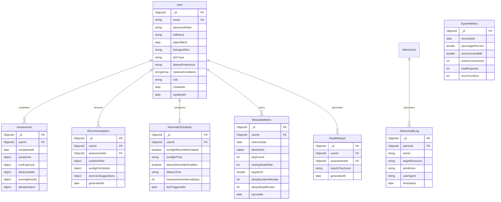

# DATABASE_SCHEMA.md — MongoDB Data Architecture & Entity Schemas

> **Engine:** MongoDB 7.0+  
> **ODM:** Mongoose v8+ with TypeScript Definitions  
> **Privacy Classification:** PHI (Protected Health Information) vs Operational Telemetry

---

## 1. Entity Relationship Overview



---

## 2. Detailed Collection Schemas

### 2.1 Collection: `users`
Stores user authentication credentials, demographic baselines, and clinical risk prerequisites.
- **Privacy Tier:** PII / Sensitive Profile
- **Schema Definition:**
```typescript
{
  _id: ObjectId,
  email: { type: String, required: true, unique: true, lowercase: true, trim: true, index: true },
  passwordHash: { type: String, required: true },
  fullName: { type: String, required: true, trim: true },
  dateOfBirth: { type: Date, required: true },
  biologicalSex: { type: String, enum: ['male', 'female', 'other'], required: true },
  skinType: { type: String, enum: ['type_1', 'type_2', 'type_3', 'type_4', 'type_5', 'type_6'], default: 'type_3' },
  dietaryPreference: { type: String, enum: ['omnivore', 'pescatarian', 'vegetarian', 'vegan'], default: 'omnivore' },
  medicalConditions: [{ type: String }], // e.g. 'celiac', 'crohns', 'kidney_disease', 'obesity'
  role: { type: String, enum: ['patient', 'admin'], default: 'patient', index: true },
  isActive: { type: Boolean, default: true },
  createdAt: { type: Date, default: Date.now },
  updatedAt: { type: Date, default: Date.now }
}
```
- **Indexes:**
  - `email`: Unique index.
  - `(role, isActive)`: Compound index for administrative filtering.

---

### 2.2 Collection: `assessments`
Stores the complete questionnaire responses, deterministic score calculations, and AI summaries.
- **Privacy Tier:** PHI (Protected Health Information) — **Strictly isolated from Admin queries**
- **Schema Definition:**
```typescript
{
  _id: ObjectId,
  userId: { type: ObjectId, ref: 'User', required: true, index: true },
  completedAt: { type: Date, default: Date.now, index: true },
  symptoms: {
    fatigueLevel: { type: String, enum: ['none', 'mild', 'moderate', 'severe'], required: true },
    bonePainLevel: { type: String, enum: ['none', 'mild', 'moderate', 'severe'], required: true },
    muscleWeaknessLevel: { type: String, enum: ['none', 'mild', 'moderate', 'severe'], required: true },
    moodChanges: { type: String, enum: ['none', 'mild', 'moderate', 'severe'], required: true },
    frequentInfections: { type: Boolean, default: false }
  },
  sunExposure: {
    dailyMinutesOutdoors: { type: Number, min: 0, max: 720, required: true },
    timeOfDay: { type: String, enum: ['early_morning', 'midday', 'late_afternoon', 'mixed'], required: true },
    clothingCoverage: { type: String, enum: ['low', 'moderate', 'high'], required: true },
    regularSunscreenSPF30: { type: Boolean, default: false }
  },
  dietaryHabits: {
    fattyFishServingsPerWeek: { type: Number, min: 0, max: 21, required: true },
    fortifiedMilkServingsPerWeek: { type: Number, min: 0, max: 28, required: true },
    eggYolksPerWeek: { type: Number, min: 0, max: 35, required: true },
    mushroomsWeekly: { type: Boolean, default: false },
    takesVitaminDSupplement: { type: Boolean, default: false }
  },
  scoringResults: {
    compositeScore: { type: Number, min: 0, max: 100, required: true },
    riskTier: { type: String, enum: ['low', 'moderate', 'high'], required: true },
    subScores: {
      symptomScore: { type: Number, required: true },
      solarDeficitScore: { type: Number, required: true },
      dietaryDeficitScore: { type: Number, required: true },
      medicalMultiplierScore: { type: Number, required: true }
    },
    doctorConsultationRequired: { type: Boolean, required: true },
    consultationUrgency: { type: String, enum: ['routine_monitoring', 'recommended_within_2_weeks', 'urgent_medical_evaluation'], required: true }
  },
  aiExplanation: {
    summary: { type: String },
    keyContributors: [{ type: String }]
  }
}
```
- **Indexes:**
  - `(userId, completedAt)`: Compound descending index for instant retrieval of patient history.

---

### 2.3 Collection: `wearable_metrics`
Stores daily biometric summaries imported via Android Health Connect.
- **Privacy Tier:** PHI (Biometric Telemetry)
- **Schema Definition:**
```typescript
{
  _id: ObjectId,
  userId: { type: ObjectId, ref: 'User', required: true, index: true },
  metricsDate: { type: String, required: true }, // Format: "YYYY-MM-DD"
  deviceInfo: {
    manufacturer: { type: String },
    model: { type: String },
    sourceApp: { type: String }
  },
  stepCount: { type: Number, min: 0, max: 100000 },
  restingHeartRate: { type: Number, min: 30, max: 220 },
  avgSpO2: { type: Number, min: 50.0, max: 100.0 },
  sleepDurationMinutes: { type: Number, min: 0, max: 1440 },
  deepSleepMinutes: { type: Number, min: 0, max: 720 },
  syncedAt: { type: Date, default: Date.now }
}
```
- **Indexes:**
  - `(userId, metricsDate)`: Unique compound index preventing duplicate entries per calendar day.

---

### 2.4 Collection: `recommendations`
Stores personalized diet, sunlight, and exercise guidance linked to specific assessments.
- **Privacy Tier:** Personal Health Guidance
- **Schema Definition:**
```typescript
{
  _id: ObjectId,
  userId: { type: ObjectId, ref: 'User', required: true, index: true },
  assessmentId: { type: ObjectId, ref: 'Assessment', required: true },
  nutritionPlan: {
    targetDailyIU: { type: String },
    priorityFoods: [{ name: String, vitaminDContent: String }],
    coFactors: [{ type: String }]
  },
  sunlightSchedule: {
    recommendedDailyMinutes: { type: Number },
    optimalWindow: { type: String },
    safeExposureGuidance: { type: String }
  },
  exerciseSuggestions: {
    focus: { type: String },
    suggestions: [{ type: String }]
  },
  generatedAt: { type: Date, default: Date.now }
}
```

---

### 2.5 Collection: `system_metrics`
Time-series collection capturing backend server health and operational telemetry.
- **Privacy Tier:** Operational / Non-PHI
- **Schema Definition:**
```typescript
{
  _id: ObjectId,
  recordedAt: { type: Date, default: Date.now, expires: '30d' }, // TTL 30 days
  cpuUsagePercent: { type: Number },
  memoryUsedMB: { type: Number },
  activeConnections: { type: Number },
  totalRequests: { type: Number },
  errorCount5xx: { type: Number },
  avgLatencyMs: { type: Number }
}
```
- **Indexes:**
  - `recordedAt`: TTL index configured for automatic cleanup after 30 days.

---

### 2.6 Collection: `admin_audit_logs`
Tracks all technical administrative actions for security compliance.
- **Privacy Tier:** Security Audit Trail
- **Schema Definition:**
```typescript
{
  _id: ObjectId,
  adminId: { type: ObjectId, ref: 'User', required: true, index: true },
  action: { type: String, required: true }, // e.g. 'VIEW_SYSTEM_HEALTH', 'EXPORT_AGGREGATE_METRICS'
  targetResource: { type: String },
  ipAddress: { type: String },
  userAgent: { type: String },
  timestamp: { type: Date, default: Date.now, expires: '90d' } // Retained 90 days
}
```

---

## 3. Data Retention & Privacy Purge Policy

1. **Patient Data Erasure:** When a user invokes their right to account deletion under DPDP Act / GDPR, a cascading delete purges records from `users`, `assessments`, `wearable_metrics`, `recommendations`, and `reminders`.
2. **Operational Log Rotation:** `system_metrics` and `admin_audit_logs` are automatically purged via MongoDB TTL indexes after 30 and 90 days, respectively.
3. **No Direct Admin Access:** No administrative query methods exist in the Mongoose DAL layer for accessing the `assessments` or `wearable_metrics` collections by user identity.
