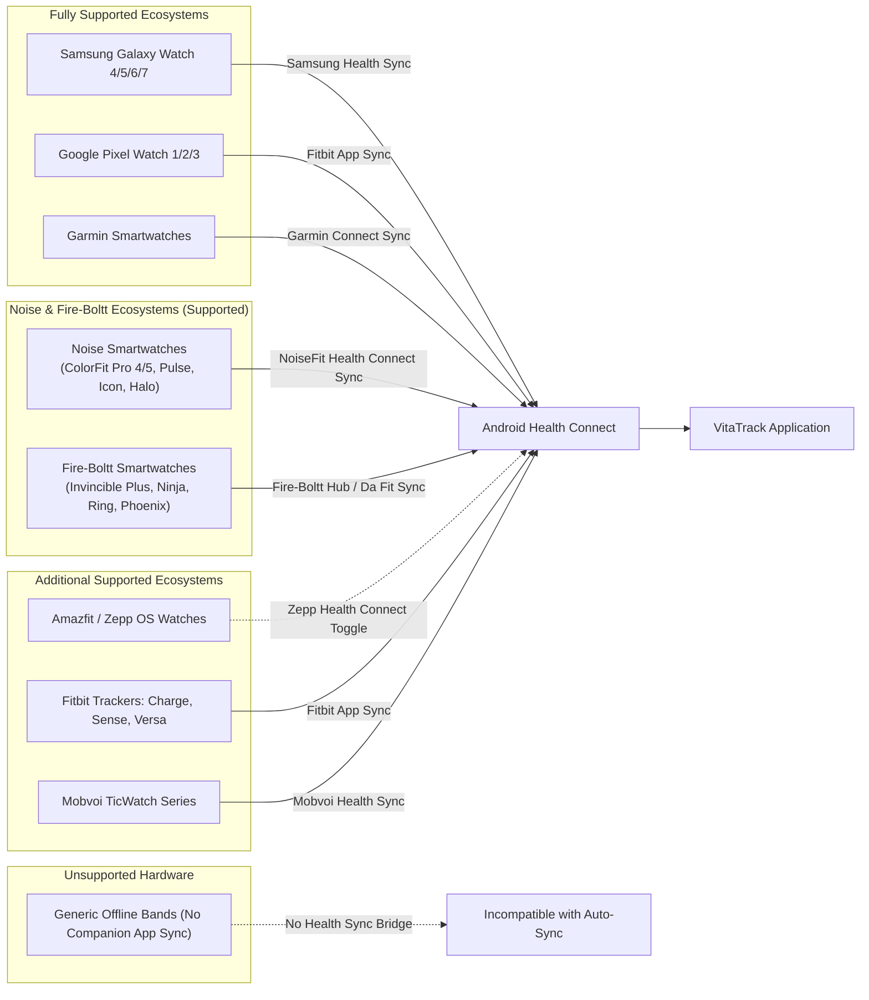

# DEVICE_COMPATIBILITY.md — Wearable & Android OS Compatibility Matrix

> **Project:** VitaTrack — Self-Diagnosis & Guidance Platform for Vitamin D Deficiency  
> **Status:** Specification Tier (Phase 0)  
> **Core Subsystem:** Hardware Integration Compatibility

---

## 1. Android Operating System Compatibility

Android Health Connect availability and architecture vary across OS generations:

| Android Version | API Level | Health Connect Integration Architecture | User Action Required | Support Status |
|:---|:---:|:---|:---|:---:|
| **Android 14 & 15+** | API 34+ | **Native Core System Service** (Pre-installed in OS settings) | None; OS permissions prompt directly | **Fully Supported** (Tier 1) |
| **Android 9 to 13** | API 28–33 | **Standalone Google Play App** (`com.google.android.apps.healthdata`) | One-time install of Health Connect APK from Play Store | **Fully Supported** (Tier 2) |
| **Android 8.1 & Older** | API $\le 27$ | Not supported by Google Health Connect framework | N/A — Wearable biometrics unavailable | **Manual Mode Only** (Self-assessment works 100%) |

---

## 2. Wearable Manufacturer Ecosystem Matrix

### 2.1 Detailed Manufacturer Compatibility Table

| Manufacturer / Series | Model Examples | Operating System | Companion Bridge App | Steps & Activity | Heart Rate | SpO₂ Saturation | Sleep Stages | Compatibility Rating |
|:---|:---|:---|:---|:---:|:---:|:---:|:---:|:---:|
| **Samsung** | Galaxy Watch 4, 5, 6, 7, Ultra | Wear OS 3.5 / 4.0 / 5.0 | Samsung Health | ✅ Yes | ✅ Yes | ✅ Yes | ✅ Full Stages | **Tier 1 (Optimal)** |
| **Google** | Pixel Watch 1, 2, 3 | Wear OS 3.5 / 4.0 / 5.0 | Google Pixel Watch / Fitbit | ✅ Yes | ✅ Yes | ✅ Yes | ✅ Full Stages | **Tier 1 (Optimal)** |
| **Fitbit** | Sense 2, Versa 4, Charge 6 | Fitbit OS | Fitbit Mobile App | ✅ Yes | ✅ Yes | ✅ Yes | ✅ Full Stages | **Tier 1 (Optimal)** |
| **Noise** | **ColorFit Pro 4, Pro 5, Pulse 2/3, Icon Buzz, Halo, Caliber, Twist** | Noise RTOS / Smart OS | NoiseFit App (Health Connect & Google Fit Bridge) | ✅ Yes | ✅ Yes | ✅ Yes | ✅ Total Sleep & Deep/Light | **Tier 2 (Fully Supported)** |
| **Fire-Boltt** | **Invincible Plus, Ninja series, Ring series, Phoenix, Gladiator, Talk** | Boltt OS / Da Fit RTOS | Fire-Boltt Health Hub / Da Fit / FitCloudPro | ✅ Yes | ✅ Yes | ✅ Yes | ✅ Total Sleep & Basic Stages | **Tier 2 (Fully Supported)** |
| **Garmin** | Forerunner, Venu, Fenix | Garmin Proprietary OS | Garmin Connect App | ✅ Yes | ✅ Yes | ✅ Yes (if equipped) | ✅ Sleep & REM | **Tier 2 (High)** |
| **Amazfit / Zepp** | GTR, GTS, Cheetah, Balance | Zepp OS | Zepp App | ✅ Yes | ✅ Yes | ⚠️ Periodic | ⚠️ Basic Sleep | **Tier 3 (Conditional)** |
| **Mobvoi** | TicWatch Pro 3, Pro 5 | Wear OS 3.0 / 3.5 | Mobvoi Health | ✅ Yes | ✅ Yes | ⚠️ Manual Sync | ⚠️ Limited | **Tier 3 (Conditional)** |
| **Generic No-Sync Bands** | Unbranded Offline Micro-Trackers | Micro-Firmware | Standalone / None | ❌ No | ❌ No | ❌ No | ❌ No | **Tier 4 (Unsupported)** |

---

## 3. Sensor Metric Availability Matrix

| Metric Parameter | Measurement Requirement | Hardware Dependency | Fallback Strategy When Missing |
|:---|:---|:---|:---|
| **Step Count** | Continuous 3-axis accelerometer | Standard on 100% of smartwatches and smartphones | Mobile phone internal pedometer (`expo-sensors`) |
| **Resting Heart Rate** | Photoplethysmography (PPG) optical sensor | Standard on Wear OS and modern fitness watches | Omit from score; does not block assessment |
| **Blood Oxygen (SpO₂)** | Red & Infrared optical sensor array | Available on mid-to-high tier smartwatches | Omit from analysis; display manual pulse oximeter entry card |
| **Sleep Duration & Stages** | Accelerometer + Heart Rate Variability (HRV) | Standard on Wear OS, Garmin, and Fitbit | Inquire via optional manual questionnaire slider |
| **UV Exposure** | Dedicated ambient UV sensor (e.g., Galaxy Watch) | Rare; limited to specific hardware | Calculate dynamically using phone location & meteorological API |

---

## 4. Graceful Degradation Invariant

> [!NOTE]
> **Core System Invariant:**  
> The inability to connect a smartwatch or retrieve biometric metrics **never degrades the core functionality of VitaTrack**. Self-assessment questionnaires, risk stratification calculations, personalized nutrition advice, safe sun guidance, and doctor consultation alerts remain 100% operational on any standard Android smartphone.
