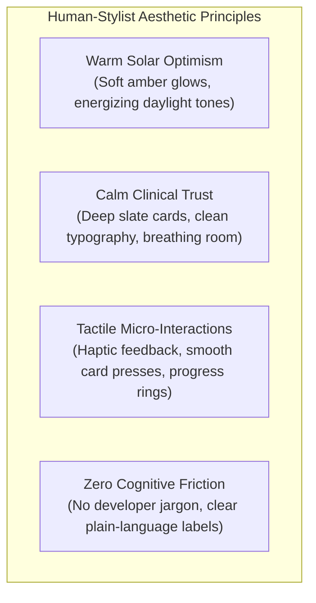
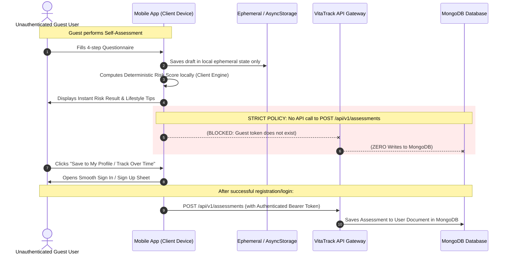
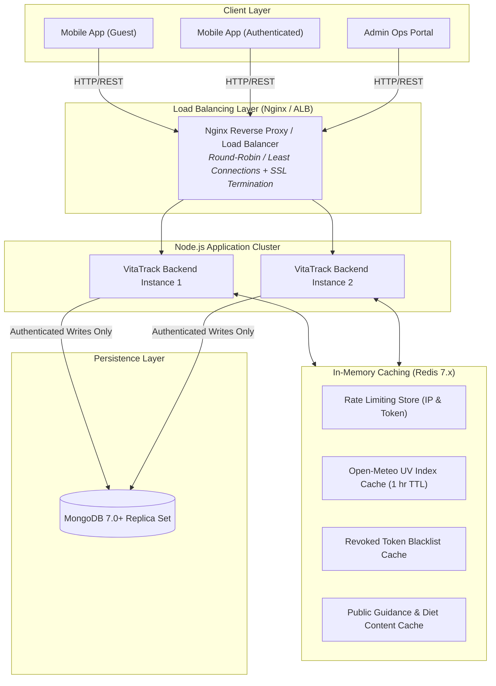

# HUMAN_UI_GUEST_REVAMP_SPEC.md — Mobile UI/UX Human Stylist & Production Architecture Specification

> **Platform:** VitaTrack Mobile (React Native + Expo SDK 52) & Backend (Node.js + Express + Redis)  
> **Status:** Specification Approved — Blueprint for Human-Centric UI Revamp & High-Availability Infrastructure  
> **Document Purpose:** Complete architectural and design requirements addressing human-stylist aesthetics, bottom tab navigation, anonymous guest exploration without DB writes, sensitive error shielding, and Redis/Load balancing.

---

## 1. Executive Summary & Core Objectives

The current mobile application contains developer-centric phase announcements (e.g., *"Phase 8 Smartwatch Ingestion Active"*, *"Hardware Keystore Vault"*), lacks a standard mobile bottom navigation bar, requires login before experiencing features, and resembles an AI-generated debug checklist rather than a premium, human-designed consumer health app.

This specification establishes four core pillars of transformation:

1. **Ultra-Realistic, Human-Stylist UI/UX:**
   - Eradicate all robotic/AI phase badges, developer jargon, and cluttered button stacks.
   - Adopt a sleek, modern, warm health aesthetic (Solar Amber, Deep Clinical Slate, Glassmorphism, responsive micro-animations).
   - Implement standard native mobile navigation: **Persistent Bottom Tab Bar** (`Home`, `Assessment`, `Guidance`, `History`, `Profile`).

2. **Guest Mode (Bina Login Exploration) with Strict Zero-DB Storage Invariant:**
   - Allow any user to open and explore the app immediately without forced sign-up or sign-in.
   - Guests can access: UI tours, daily sunlight & UV tracker, bioavailable nutrition library, educational knowledge base, and a sample self-assessment preview.
   - **Strict Zero-DB Storage Policy:** Unauthenticated/guest data is **strictly ephemeral (in-memory / local device storage only)**. Under no circumstances will unauthenticated guest records be sent to or written into MongoDB.
   - Cloud persistence, longitudinal trends, clinician PDF reports, and smartwatch synchronization are reserved for registered/authenticated accounts, with gentle and elegant upgrade prompts.

3. **Sensitive Message Shield & Human-Readable Copy:**
   - Clean, friendly, reassuring copy everywhere (e.g., *"Welcome to your daily health summary"* instead of *"Phase 4 Deterministic Risk & AI Explainer Engine Active"*).
   - Never expose raw stack traces, MongoDB connection errors, encryption parameters, or API error codes to the user.
   - Contextual, graceful fallback messages for network or sensor drops.

4. **Production Scalability Architecture (Load Balancing & Redis Caching):**
   - High-throughput architecture featuring Nginx / ALB reverse proxy load balancing.
   - Redis in-memory cache for API rate limiting, session revocation, UV weather data caching, and read-through content caching to minimize MongoDB load.

---

## 2. Human Stylist Mobile UI/UX Design System

### 2.1 Design Philosophy: "Warmth Meets Clinical Trust"



### 2.2 Color Tokens & Visual Balance

| Token Name | Hex Code | HSL / Opacity | Purpose |
|:---|:---|:---|:---|
| **Solar Amber (Primary)** | `#F59E0B` | HSL 38, 92%, 50% | Primary buttons, sunlight gauges, active tab highlights |
| **Solar Dawn (Accent)** | `#EA580C` | HSL 21, 90%, 48% | Highlighting peak sun hours, urgent clinical reminders |
| **Deep Slate Surface** | `#0B0F19` | HSL 222, 47%, 7% | Immersive, battery-efficient dark surface |
| **Glass Card Surface** | `rgba(30, 41, 59, 0.70)` | Blur 16px | Floating glassmorphism cards with subtle 1px border (`#334155`) |
| **Text Primary (Human)** | `#F8FAFC` | 100% Slate 50 | Clear headlines, vital statistics, screen titles |
| **Text Secondary** | `#94A3B8` | 100% Slate 400 | Empathetic descriptions, helper subtexts, timestamps |
| **Success Emerald** | `#10B981` | HSL 152, 69%, 40% | Safe vitamin D levels, completed daily goals |
| **Clinical Amber** | `#F59E0B` | HSL 38, 92%, 50% | Moderate risk alert, recommendation to review sunlight |
| **Clinical Alert Crimson**| `#EF4444` | HSL 0, 84%, 60% | Elevated risk advisory, recommended doctor consultation |

### 2.3 Typography & Copywriting Guidelines: Before vs After

| Location | ❌ Old AI / Debug Message | ✅ New Human-Stylist Copy |
|:---|:---|:---|
| **Home Hero** | `Phase 8 Smartwatch & Wearable Biometric Ingestion Active` | `Good morning! Track your solar vitality and daily wellness.` |
| **Auth Card** | `Logged in as satyam@vgu.ac.in • Skin TYPE_3 • VEGAN` | `Jane Doe • Balanced Lifestyle • Daily Goal: 20 min Sun` |
| **Risk Card** | `Phase 4 Deterministic Risk & AI Explainer Engine` | `Your Vitamin D Health Score & Vitality Summary` |
| **Questionnaire** | `Phase 3 Clinical Questionnaire Active` | `3-Minute Health Checkup (Quick & Confidential)` |
| **Wearables** | `Android Health Connect OS Biometric Broker Ingestion` | `Connected Watch & Activity Sync` |
| **Error Alert** | `MongooseError: Connection timeout at 127.0.0.1:27017` | `Unable to connect right now. We'll refresh automatically when online.` |
| **Profile** | `Hardware Keystore Token Rotation & Zero-PHI Vault` | `Privacy & Data Security (Protected on your device)` |

---

## 3. Native Mobile Navigation Architecture (Bottom Tab Bar)

The application transitions from a single long vertical button list to a **Native Bottom Tab Navigation Bar** (`/(tabs)`):

```mermaid
flowchart TD
    subgraph RootNavigation ["Root Navigation Flow"]
        ENTRY["App Launch"] --> DETECT{"Is User Logged In?"}
        DETECT -->|Yes| AUTH_TABS["Main App Tabs (Authenticated)"]
        DETECT -->|No (Guest)| GUEST_TABS["Main App Tabs (Guest Preview Mode)"]
    end

    subgraph MainTabs ["Standard Bottom Navigation Bar (5 Tabs)"]
        TAB1["🏠 Home<br/>Daily Overview, Sun Tracker, Today's Tip"]
        TAB2["📝 Checkup<br/>Self-Assessment Wizard & Instant Score"]
        TAB3["☀️ Guidance<br/>Solar Timer, Diet Recipes & Bone Exercises"]
        TAB4["📊 Trends<br/>Health Trajectory & Doctor PDF Report"]
        TAB5["👤 Profile<br/>Settings, Device Sync, Account / Sign In"]
    end

    AUTH_TABS --> MainTabs
    GUEST_TABS --> MainTabs
```

### 3.1 Tab Breakdown & Access Matrix

| Tab Name | Route | What Guest Users See | What Authenticated Users See |
|:---|:---|:---|:---|
| **Home** | `/(tabs)/index` | Daily UV tracker, solar timer preview, health tips, CTA to try checkup. Realistic sample preview data. | Full personalized dashboard: last score badge, active sunlight progress ring, synced biometrics. |
| **Checkup** | `/(tabs)/assessment` | Full interactive questionnaire preview. On complete: instant local risk gauge. Shows *"Save to your profile"* prompt. | Full questionnaire with cloud auto-save, risk history logging, personalized AI insights. |
| **Guidance** | `/(tabs)/guidance` | Full access to recipes (vegan/vegetarian/omnivore), live sunlight countdown timer with UV warnings, exercise tips. | Tailored recommendations matching authenticated profile, saved favorite routines. |
| **Trends** | `/(tabs)/history` | Elegant preview illustration + *"Track your progress over time. Create a free account to unlock historical trends and doctor reports."* | Interactive trend charts, historical checkup logs, downloadable Clinician PDF. |
| **Profile** | `/(tabs)/profile` | Guest banner: *"You are exploring as a Guest."* Big prominent *"Sign In / Create Account"* button, App Info, Privacy FAQ. | Full profile: Name, skin phototype, dietary preferences, Wearable sync toggle, Cloud backup status, Sign Out. |

---

## 4. Guest Mode Architecture & Strict Zero-DB Storage Policy

### 4.1 Strict Invariant: No Guest Data in Database



### 4.2 Data Storage Rules

1. **Guest Users:**
   - Assessment answers: Stored only in React state (`Zustand guestStore`) or temporary device storage.
   - Risk scoring: Calculated using the client-side deterministic scoring utility.
   - Wearable sync: Disabled (displays friendly prompt to sign in).
   - Database impact: **0 bytes written to MongoDB**.
   - Server requests allowed: `GET /api/v1/guidance/public-uv`, static health content (cached).

2. **Authenticated Users:**
   - Full two-way synchronization with MongoDB via authenticated endpoints (`Authorization: Bearer <jwt>`).
   - Longitudinal history records, PDF clinician exports, Wearable Health Connect ingestion.

---

## 5. Sensitive Message Shield & Privacy Error Handling

Users should never encounter raw system jargon or technical errors. The mobile client and backend API implement a strict **Sensitive Message Shield**:

### 5.1 Client-Side Error Sanitization Filter

```typescript
// Proposed Client Error Formatter
export function getFriendlyErrorMessage(error: any): string {
  // If network unreachable
  if (error.message?.includes('Network request failed') || error.code === 'ECONNREFUSED') {
    return "We're having trouble connecting to the network. Please check your internet connection and try again.";
  }
  // If session expired
  if (error.response?.status === 401) {
    return "Your session has expired. Please sign in again to continue.";
  }
  // If server internal error (Never expose Mongoose, MongoDB, or Node stack)
  if (error.response?.status >= 500) {
    return "Our health servers are currently busy. Your data is safe; please try again in a few moments.";
  }
  // Default fallback
  return "Something went wrong. Please try again.";
}
```

### 5.2 Scrubbing Technical Information from UI

- **No phase numbers** on any user-facing screen (no "Phase 1", "Phase 8", etc.).
- **No cryptographic buzzwords** in the main flow (replace "Hardware Keystore Zero-PHI Vault" with "Protected by Biometric Security").
- **No AI model names** displayed to patients (replace "Gemini 1.5 Flash Synthesizer" with "Personalized Health Insights").

---

## 6. High-Availability Backend Architecture: Redis Caching & Load Balancing

To support smooth performance, fast responses, and prevent database saturation:



### 6.1 Redis Cache Key Schema

| Key Pattern | TTL | Purpose | Benefit |
|:---|:---|:---|:---|
| `uv:cache:{lat}:{lon}` | 3600s (1 hr) | Caches external solar/UV index for coordinates | Avoids exceeding external Open-Meteo API limits |
| `rate:ip:{clientIp}` | 60s | Distributed sliding-window rate limiting | Protects against DDoS or rapid unauthenticated spam |
| `token:blacklist:{jti}` | Token lifetime | Revoked JWT tokens on logout | Instant revocation without expensive DB queries |
| `content:diet:{category}` | 86400s (24 hrs) | Static dietary food lists & bioavailable recipes | Serves thousands of guest users without touching MongoDB |

### 6.2 Load Balancing Configuration (Nginx / Reverse Proxy)

- **Algorithm:** `least_conn` or `round_robin` across upstream backend application instances.
- **Health Checks:** Periodic ping to `/api/health` with automatic failover.
- **Client IP Preservation:** `X-Forwarded-For` and `X-Real-IP` headers passed to rate limiters.
- **SSL/TLS 1.3 Termination:** High-security cipher suites, offloading cryptographic overhead from Node.js.

---

## 7. Implementation Roadmap & Execution Checklist

### Phase A: Mobile Navigation & Shell Revamp (Immediate Priority)
- [ ] Implement Expo Router `(tabs)` bottom navigation bar with 5 polished tabs:
  - 🏠 Home (`apps/mobile/app/(tabs)/index.tsx`)
  - 📝 Checkup (`apps/mobile/app/(tabs)/assessment.tsx`)
  - ☀️ Guidance (`apps/mobile/app/(tabs)/guidance.tsx`)
  - 📊 Trends (`apps/mobile/app/(tabs)/history.tsx`)
  - 👤 Profile (`apps/mobile/app/(tabs)/profile.tsx`)
- [ ] Design sleek custom icons, active solar amber pill indicators, and haptic tab-press feedback.

### Phase B: Home Screen Human-Stylist Polish
- [ ] Strip out all phase status cards and developer debug text from `index.tsx`.
- [ ] Build a stunning Hero Card: Daily Solar synthesis score ring, local UV index indicator, quick "Start Checkup" CTA.
- [ ] Add Daily Wellness Insight card with rotating human-friendly health tips.
- [ ] Add Wearable Activity preview card (realistic preview numbers for guests; synced Health Connect metrics for logged-in users).

### Phase C: Guest Mode (Bin Login) & Strict Zero-DB Rule
- [ ] Update `AuthContext` to support a `guest` state without requiring email/password.
- [ ] Guest users can complete the checkup wizard and see their instant score without login.
- [ ] Ensure assessment submit logic blocks backend API POST when user is in guest mode; keep data in client memory only.
- [ ] Present non-intrusive "Save to Profile" modal on the results screen.
- [ ] Only persist to MongoDB after the user signs in or creates an account.

### Phase D: Sensitive Error Masking & Copy Polish
- [ ] Implement `FriendlyErrorToast` and global error boundary that catches errors and presents warm, polite messages.
- [ ] Audit all strings in `assessment`, `results`, `guidance`, `history`, `reminders`, `wearables`, and `profile` to guarantee natural, compassionate, human-first medical language.

### Phase E: Backend Redis Caching & Reverse Proxy Load Balancing Spec
- [ ] Document Docker Compose setup for Redis service.
- [ ] Implement Redis adapter for express-rate-limit and UV weather cache.
- [ ] Add Nginx reverse proxy configuration template.
