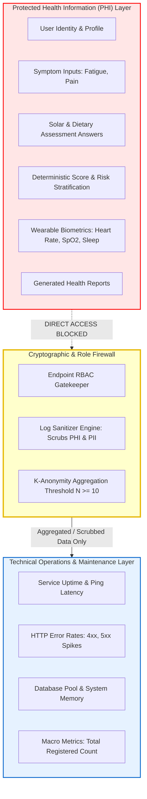
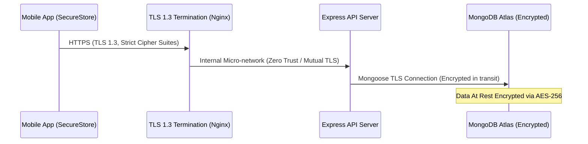

# SECURITY_PRIVACY.md — Security Architecture, Privacy Safeguards & PHI Isolation

> **Project:** VitaTrack — Self-Diagnosis & Guidance Platform for Vitamin D Deficiency  
> **Status:** Specification Tier (Phase 0)  
> **Regulatory Foundations:** Digital Personal Data Protection (DPDP) Act 2023 (India) & HIPAA Security Rule Alignment

---

## 1. Zero-PHI Admin Privacy Barrier

VitaTrack enforces a structural privacy barrier dividing patient healthcare data from technical operations:



### 1.1 The Inviolable Admin Rules
1. **Zero Access to Clinical Records:** The admin web portal and administrative API endpoints (`/api/v1/admin/*`) **shall never** receive or query individual symptoms, assessment answers, composite scores, risk categories, AI summaries, clinician PDF reports, or wearable biometric streams.
2. **K-Anonymity Aggregation Threshold ($N \ge 10$):** Demographic and statistical breakdowns (e.g., percentage of assessments in Moderate tier) are computed across macro populations and never exposed if the sample cohort is smaller than 10 users, preventing inference attacks.
3. **No Patient Search by Name/Email:** Admin interfaces have no search bar or look-up utility that returns an individual patient's medical records or assessment trajectory.

---

## 2. Authentication & Credential Security

- **Password Storage:** User passwords are never saved in plaintext. They are salted and hashed using **bcrypt** with a minimum work factor of 12 (`bcrypt.hash(password, 12)`).
- **Session Tokens (JWT):**
  - **Access Tokens:** Signed via HMAC SHA-256 (`HS256`) or asymmetric `RS256`, strictly short-lived with a **15-minute expiration**. The payload contains only `{ userId, role, tokenVersion }` — zero clinical data.
  - **Refresh Tokens:** Cryptographically random 256-bit hex strings stored in hashed form in the database. They carry a 7-day validity and employ **strict single-use rotation**. Attempting to reuse an old refresh token invalidates all active sessions for that account (compromise detection).
- **Rate Limiting:**
  - Login & registration endpoints: Capped at 5 attempts per IP per 15 minutes (`express-rate-limit`).
  - Standard REST APIs: Capped at 100 requests per minute per authenticated user.

---

## 3. Mobile Device Security & Token Storage

- **Hardware-Backed Key Storage:** On mobile (Android & iOS), JWT access and refresh tokens are stored exclusively using `Expo SecureStore`, which interfaces with:
  - **Android Keystore:** Hardware-backed encryption via AES-GCM.
  - **iOS Keychain:** Secure Enclave access.
- **No Insecure Storage:** Tokens and clinical questionnaire drafts are strictly forbidden from being stored in unencrypted `localStorage` or plaintext SQLite databases.
- **Memory Hygiene:** Tokens are loaded into transient JavaScript memory only when dispatching API requests and purged upon sign-out.

---

## 4. Encryption in Transit & At Rest



- **In Transit:** All communications require **TLS 1.3**. Legacy ciphers and insecure TLS versions ($< 1.2$) are disabled at the reverse proxy. HTTP Strict Transport Security (`HSTS`) headers enforce secure transport.
- **At Rest:** Database volumes on MongoDB Atlas utilize hardware AES-256 disk encryption.

---

## 5. Application Server Log Sanitization

Server logs (managed via `Winston` or `Morgan`) must never capture sensitive clinical or credential attributes. A dedicated redaction middleware scrubs log payloads before writing to standard output:

```typescript
// Architectural Rule: Redaction Middleware Filter
const REDACTED_KEYS = [
  'password',
  'token',
  'refreshToken',
  'symptoms',
  'fatigueLevel',
  'bonePainLevel',
  'muscleWeaknessLevel',
  'scoringResults',
  'compositeScore',
  'stepCount',
  'restingHeartRate',
  'avgSpO2',
  'sleepDurationMinutes'
];

function sanitizeForLogging(obj: any): any {
  if (!obj || typeof obj !== 'object') return obj;
  const clone = Array.isArray(obj) ? [...obj] : { ...obj };
  for (const key of Object.keys(clone)) {
    if (REDACTED_KEYS.includes(key)) {
      clone[key] = '[REDACTED_HEALTH_SECURITY_DATA]';
    } else if (typeof clone[key] === 'object') {
      clone[key] = sanitizeForLogging(clone[key]);
    }
  }
  return clone;
}
```

---

## 6. Regulatory Compliance Alignment

### 6.1 India Digital Personal Data Protection (DPDP) Act 2023
- **Explicit Consent:** During onboarding, users review a plain-language consent agreement explaining why their age, symptoms, solar exposure, and wearable metrics are processed.
- **Purpose Limitation:** Health data is used strictly to compute self-assessment risk and display lifestyle guidance. It is never sold, shared with ad networks, or repurposed.
- **Right to Erasure & Correction:** Users can request immediate permanent deletion of their account and all associated assessment history directly from the Settings screen.

### 6.2 Medical Device & Health Data Boundaries
- **Diagnostic Boundary Labeling:** VitaTrack explicitly labels all outputs as self-assessment screening and guidance.
- **Safety Fallback:** Clinically elevated risk profiles trigger mandatory prompts urging formal medical laboratory serum testing ($25(\text{OH})\text{D}$).
