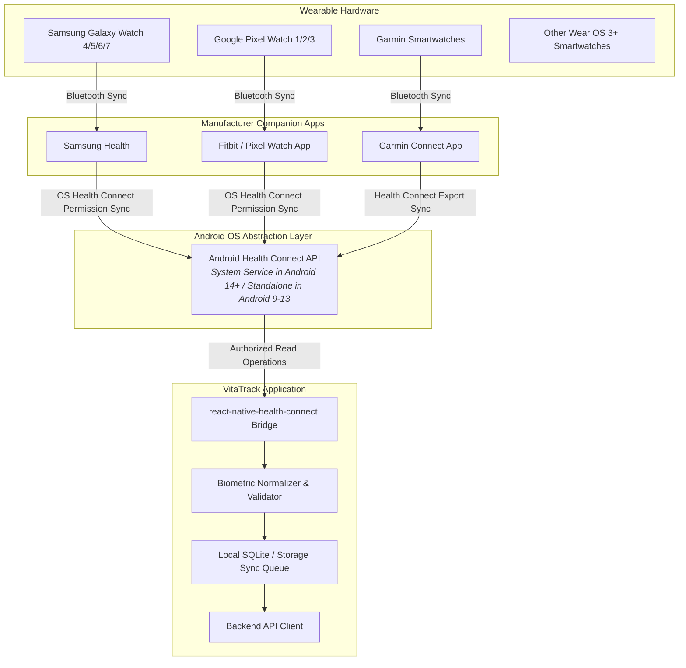
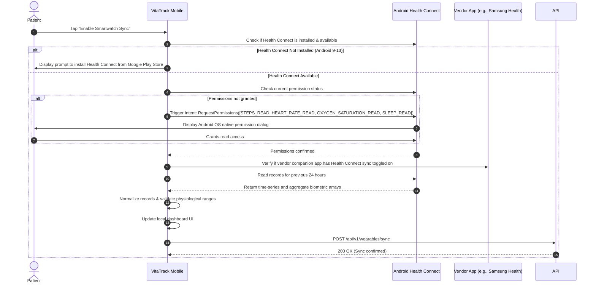

# SMARTWATCH_INTEGRATION.md — Wearable Integration & Biometric Sync Architecture

> **Project:** VitaTrack — Self-Diagnosis & Guidance Platform for Vitamin D Deficiency  
> **Target Subsystem:** Phase 8 Wearable Ingestion  
> **Primary Integration Bridge:** Google Android Health Connect API (`androidx.health.connect`)

---

## 1. Architectural Strategy & Reality-Based Principles

Wearable integration in Android is fragmented across proprietary ecosystems (Samsung Health, Google Pixel Watch/Fitbit, Garmin Connect, Amazfit/Zepp, Wear OS). To deliver a stable, privacy-compliant architecture without requiring dozens of proprietary SDKs, VitaTrack adopts **Android Health Connect** as the centralized, OS-level biometric data broker.



> [!IMPORTANT]
> **Realistic Hardware Integration Boundary:**  
> VitaTrack does **not** establish direct low-level Bluetooth LE connections to smartwatches. Smartwatches sync to their official manufacturer companion applications (e.g. Samsung Health, Fitbit), which in turn sync data into Android Health Connect. VitaTrack requests granular user permissions from Health Connect to read authorized data points. **If a manufacturer's app does not sync a metric to Health Connect, or if the user's watch lacks a specific hardware sensor, that metric will not be available in VitaTrack.**

---

## 2. Supported Metrics & Clinical Correlation

| Biometric Metric | Health Connect Record Type | Minimum Sampling Granularity | Relevance to Vitamin D Lifestyle Analysis |
|:---|:---|:---|:---|
| **Step Count & Activity** | `StepsRecord`, `ActiveCaloriesBurnedRecord` | Daily Aggregated Sum | Evaluates outdoor mobility and sedentary lifestyle risk factors. |
| **Resting Heart Rate** | `HeartRateRecord` (Resting Filter) | Daily Resting Baseline (BPM) | General cardiovascular marker; helps monitor baseline recovery. |
| **Blood Oxygen Saturation (SpO₂)** | `OxygenSaturationRecord` | Percentage (Daily Mean / Sleep) | Chronic low SpO₂ combined with fatigue flags systemic fatigue requiring medical workup. |
| **Sleep Duration & Sleep Stages** | `SleepSessionRecord`, `SleepStageRecord` | Total Sleep Minutes, REM, Deep Sleep | Chronic sleep disruption combined with fatigue helps differentiate sleep debt from deficiency symptoms. |
| **Ambient Solar / UV Exposure** | *Hardware Limited* (Pixel Watch / Galaxy Watch) | Minutes Outdoors | Ingested when device light/UV sensor exposes data to Health Connect. |

---

## 3. Permission Request & Ingestion Workflow



---

## 4. Data Normalization & Validation Rules

Biometric data imported from external sources must pass strict physiological boundary checks before ingestion:

```typescript
export interface NormalizedBiometrics {
  stepCount: number;
  restingHeartRate?: number;
  avgSpO2?: number;
  sleepDurationMinutes?: number;
  deepSleepMinutes?: number;
}

export function validateAndNormalizeBiometrics(raw: any): NormalizedBiometrics {
  const result: NormalizedBiometrics = {
    stepCount: Math.min(Math.max(raw.steps || 0, 0), 100000)
  };

  // Heart rate validation: 30 to 220 bpm
  if (raw.heartRate && raw.heartRate >= 30 && raw.heartRate <= 220) {
    result.restingHeartRate = Math.round(raw.heartRate);
  }

  // SpO2 validation: 50% to 100%
  if (raw.spO2 && raw.spO2 >= 50.0 && raw.spO2 <= 100.0) {
    result.avgSpO2 = parseFloat(raw.spO2.toFixed(1));
  }

  // Sleep validation: 0 to 1440 minutes (24 hours)
  if (raw.sleepMinutes && raw.sleepMinutes >= 0 && raw.sleepMinutes <= 1440) {
    result.sleepDurationMinutes = Math.round(raw.sleepMinutes);
  }

  return result;
}
```

---

## 5. Offline Queueing & Battery Optimization

- **Zero Foreground Polling:** VitaTrack does not run continuous foreground polling loops that drain battery.
- **On-Demand & Scheduled Sync:**
  1. *Manual:* User taps "Sync Now" button on the Wearable dashboard.
  2. *Opportunistic:* Sync occurs once per day when the user opens the application.
  3. *Background:* Periodic Android `WorkManager` job scheduled once every 12 hours (only when battery level $> 20\%$ and connected to unmetered Wi-Fi / cellular).
- **Offline Resilience:** If device is offline when Health Connect records are read, normalized records are queued in local SQLite storage and uploaded on next network reconnect.

---

## 6. Real-World Limitations & Vendor Restrictions

1. **Vendor Sync Delays:** Data from smartwatches is not real-time in Health Connect; Samsung Health and Fitbit typically sync biometrics in batches every 15–60 minutes.
2. **Sensor Variability:** Low-cost or budget fitness bands may lack optical SpO₂ sensors or sleep stage algorithms, resulting in null fields.
3. **No Direct Wear OS APK in Phase 8:** Phase 8 focuses on ingesting data via Health Connect on the mobile companion phone. A dedicated standalone Wear OS app is an open future consideration.
