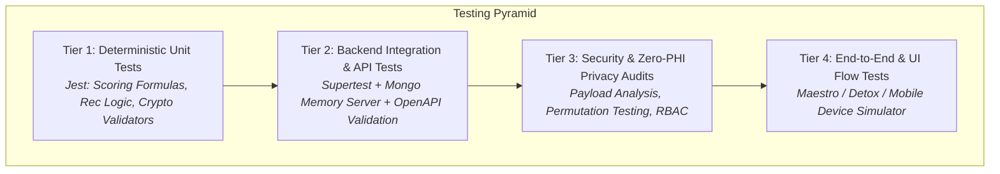

# TEST_PLAN.md — Comprehensive Verification & Quality Assurance Strategy

> **Project:** VitaTrack — Self-Diagnosis & Guidance Platform for Vitamin D Deficiency  
> **Status:** Specification Phase (Phase 0) — Planned Test Protocols

---

## 1. Testing Philosophy & Verification Tiers

VitaTrack employs a multi-layered quality assurance matrix ensuring clinical reliability, mathematical precision in scoring, data privacy compliance, and mobile resilience.



---

## 2. Test Suites & Scope

### Tier 1: Unit Testing (Jest / TypeScript)
- **Scoring Engine:** Verifies that deterministic risk scoring algorithms produce exact expected outputs for reference symptom/solar/diet permutations.
- **Dietary & Solar Recommender:** Verifies that recommendations match user constraints (e.g., vegan users receive plant-based Vitamin D2 and lichen-derived D3 suggestions; high UV index limits exposure duration).
- **Security Utilities:** Verifies password hashing (bcrypt), token expiration math, and data sanitizers.

### Tier 2: Integration Testing (Supertest + Mongo Memory Server)
- **Authentication Flows:** Registration, duplicate email rejection, login, token rotation, and invalid token handling.
- **Assessment Lifecycle:** Creating an assessment, calculating results, verifying persistence in MongoDB, and retrieving past history.
- **Wearable Ingestion:** Syncing biometric payloads, data deduplication, and schema validation.

### Tier 3: Security & Privacy Audits
- **Zero-PHI Admin Test:** Automated tests asserting that admin endpoints **never** expose personal health information, symptom answers, risk scores, or wearable biometrics.
- **Log Sanitation Test:** Automated capture of server logs asserting that passwords, tokens, and medical attributes are scrubbed.
- **Rate Limiting & Injection Protection:** Testing brute-force protections on auth endpoints and NoSQL query injection prevention.

### Tier 4: Mobile UI & Hardware Compatibility Tests
- **Multi-Step Questionnaire UI:** Validating navigation forward/backward, progress bar animation, slider responsiveness, and error validation.
- **Offline Draft Persistence:** Verifying that partially filled surveys survive app reloads.
- **Wearable Health Connect Mocking:** Simulating granted, denied, and missing Health Connect permissions and validating UI fallbacks.
- **PDF Report Generation:** Validating that `expo-print` renders formatted clinician summaries with proper data binding.

---

## 3. Master Test Case Inventory

| Test Case ID | Test Suite | Description | Expected Outcome | Priority |
|:---|:---|:---|:---|:---:|
| `TC-SCORE-01` | Unit: Scoring | Compute score for minimal symptoms, high sun exposure, rich diet | Score $\le 20$, Stratification: `Low Risk`, no doctor alert | P0 |
| `TC-SCORE-02` | Unit: Scoring | Compute score matching PPT Slide 7: High fatigue, moderate bone pain, low sun | Score $50–65$, Stratification: `Moderate Risk`, doctor alert active | P0 |
| `TC-SCORE-03` | Unit: Scoring | Compute score for severe symptoms, zero midday sun, strict vegan, elderly ($age \ge 65$) | Score $\ge 75$, Stratification: `High Risk`, urgent doctor alert active | P0 |
| `TC-SCORE-04` | Unit: Scoring | Test boundary conditions: score cannot exceed 100 or drop below 0 | Clamped strictly to $[0, 100]$ | P0 |
| `TC-AUTH-01` | Integration: Auth | Register new user with valid email & strong password | User created, password hashed with bcrypt, 201 status | P0 |
| `TC-AUTH-02` | Integration: Auth | Attempt registration with already registered email | Rejection with 409 Conflict error, no data corrupted | P0 |
| `TC-AUTH-03` | Integration: Auth | Login with valid credentials | 200 OK, returns short-lived access token & refresh token | P0 |
| `TC-AUTH-04` | Integration: Auth | Refresh token rotation | Old refresh token invalidated, new key pair issued | P1 |
| `TC-ASSESS-01`| Integration: Assessment | Submit complete assessment payload via API | Persisted in DB, returns calculated risk score & advice | P0 |
| `TC-ASSESS-02`| Integration: Assessment | Submit assessment with missing required fields | 400 Bad Request with Zod validation details | P0 |
| `TC-REC-01` | Unit: Guidance | Generate dietary suggestions for vegan profile | Includes UV mushrooms, fortified soy, lichen D3; zero fish | P1 |
| `TC-REC-02` | Unit: Guidance | Calculate sun exposure for Fitzpatrick Type I (Fair) vs Type VI (Dark) | Fair skin receives shorter duration (e.g. 10m); Type VI receives 30m+ | P1 |
| `TC-WEAR-01` | Integration: Wearable | Ingest valid Health Connect biometric payload | Record saved in `WearableMetric`, deduplicated by date | P1 |
| `TC-WEAR-02` | Integration: Wearable | Submit biometric payload with invalid heart rate ($> 300\text{ bpm}$) | 400 Validation Error, rejected by schema | P1 |
| `TC-PRIV-01` | Security: Privacy | Admin requests `/api/v1/admin/metrics` | Response contains macro counts only; zero patient records | P0 |
| `TC-PRIV-02` | Security: Privacy | Non-admin user attempts access to admin endpoint | 403 Forbidden | P0 |
| `TC-PRIV-03` | Security: Privacy | Inspect server logs after assessment submission | Log contains HTTP method & status; body scrubbed of symptoms | P0 |
| `TC-UI-01` | Mobile UI | Complete assessment survey flow on mobile | Fluid navigation, progress updates, results gauge rendered | P1 |
| `TC-UI-02` | Mobile UI | Close app mid-assessment and reopen | Previously entered answers restored from local draft cache | P2 |
| `TC-UI-03` | Mobile UI | Generate PDF report and trigger share sheet | PDF successfully created with correct patient data and disclaimer | P1 |
| `TC-HARD-01` | Mobile Native | Health Connect missing on older Android device | App displays informational notice; manual flow unimpaired | P1 |

---

## 4. Test Execution & CI/CD Pipeline

When implementation begins, tests will run automatically on every pull request and push to main branches:

```yaml
# Planned GitHub Actions Workflow Outline
name: VitaTrack Continuous Integration
on: [push, pull_request]
jobs:
  test-backend:
    runs-on: ubuntu-latest
    steps:
      - uses: actions/checkout@v4
      - uses: actions/setup-node@v4
        with: { node-version: '20.x' }
      - run: npm ci
      - run: npm run lint
      - run: npm run test:unit
      - run: npm run test:integration
      - run: npm run test:privacy-audit
```
