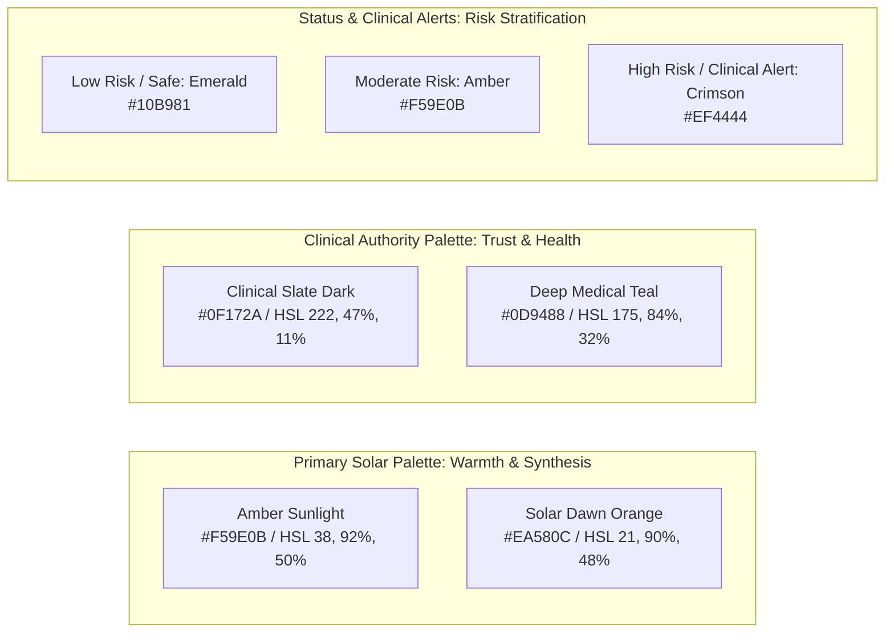
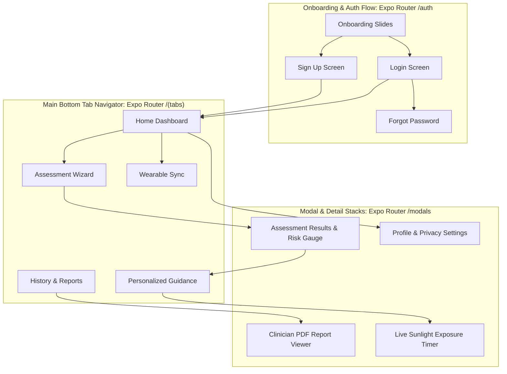
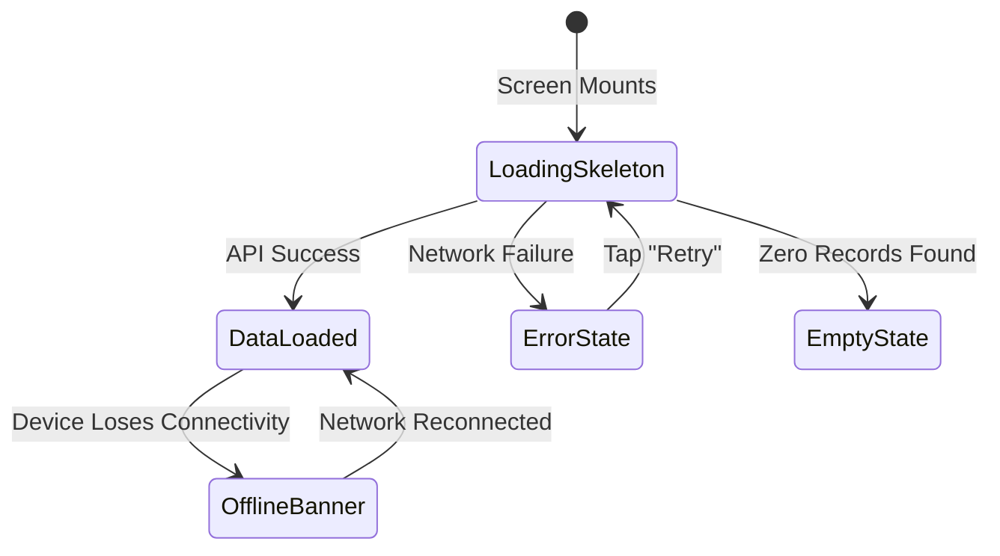
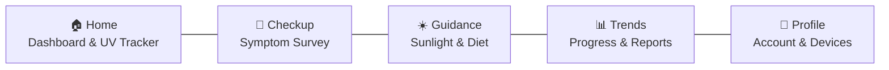

# UI_UX_SPEC.md — Mobile UI/UX Design System & Screen Specifications

> **Platform:** React Native (Expo SDK 52+) with Expo Router  
> **Aesthetic Philosophy:** Clinical Precision meets Energizing Warmth (Solar Amber & Clinical Slate)  
> **Typography:** Inter & Outfit (Modern Geometric Sans)

---

## 1. Visual Design System & Design Tokens

VitaTrack's aesthetic combines the trustworthy authority of a clinical application with the warm, energizing optimism of solar wellness.

### 1.1 Curated Color Palette

- **Light Mode Surface:** `#F8FAFC` (Slate 50)
- **Dark Mode Surface:** `#0B0F19` (Deep Midnight Blue)
- **Glassmorphism Card Effect:** `rgba(255, 255, 255, 0.85)` with `backdrop-filter: blur(12px)` and subtle border `rgba(255, 255, 255, 0.2)`.

### 1.2 Typography Hierarchy
- **Display 1 (Results & Scores):** Outfit Bold, 36sp, line-height 44sp.
- **Heading 1 (Screen Titles):** Outfit SemiBold, 24sp, line-height 32sp.
- **Heading 2 (Card Headers):** Inter SemiBold, 18sp, line-height 24sp.
- **Body Regular:** Inter Regular, 15sp, line-height 22sp.
- **Caption & Disclaimers:** Inter Medium, 12sp, line-height 16sp, muted slate `#64748B`.

---

## 2. Navigation Architecture & Screen Hierarchy

---

## 3. Screen Specifications & Wireframe Layouts

### 3.1 Screen: Home Dashboard (`/(tabs)/index`)
- **Header:** Personalized greeting ("Good Morning, Jane"), notification bell icon, profile avatar.
- **Primary Hero Card:**
  - *If assessment completed:* Circular score badge (e.g. `62 Moderate Risk`), last assessed date, "Retake Assessment" button.
  - *If new user:* High-impact welcome card: "Discover your Vitamin D status in 3 minutes" with glowing CTA "Start Self-Assessment".
- **Daily Sun Tracker Card:** Progress ring showing outdoor sunlight minutes today (e.g. `12 / 20 min goal`), current local UV Index (`UV 4.2 - Moderate`), and optimal exposure window.
- **Quick Metric Carousel:** Wearable sync status (Steps, Resting Heart Rate, Sleep Duration).
- **Educational Knowledge Card:** "Why Vitamin D matters for bone and immune health" (links to article).

### 3.2 Screen: Multi-Step Assessment Wizard (`/(tabs)/assessment`)
- **Top Bar:** Step indicator (`Step 2 of 4`), back button, animated segmented progress bar.
- **Card-Based Questionnaire Steps:**
  - **Step 1: Symptom Inventory:**
    - Fatigue Severity: Segmented selector (`None`, `Mild`, `Moderate`, `Severe`).
    - Bone & Joint Pain: Segmented selector with anatomical hint.
    - Muscle Weakness / Cramps: Interactive card picker.
    - Mood Changes & Recurrent Infections toggles.
  - **Step 2: Sunlight & Outdoor Exposure:**
    - Daily outdoor minutes slider (`0 to 120+ min`).
    - Typical time of day picker (Morning, Midday, Afternoon).
    - Clothing coverage visual cards (Minimal, Moderate, High Coverage).
    - Regular sunscreen SPF 30+ toggle.
  - **Step 3: Dietary Patterns:**
    - Weekly intake frequency steppers for Fatty Fish, Fortified Milk, Egg Yolks, Mushrooms.
    - Dietary preference radio group (Omnivore, Vegetarian, Vegan).
    - Current Vitamin D supplement checkbox.
  - **Step 4: Summary & Submission:**
    - Review entered answers with quick edit links.
    - Submit button with haptic feedback and loading spinner.

### 3.3 Screen: Assessment Results & Risk Gauge (`/modals/results`)
- **Visual Risk Gauge:** Custom animated circular SVG gauge filling from 0 to 100 with color gradient:
  - Green ($0–39$): Low Risk
  - Amber ($40–69$): Moderate Risk
  - Red ($70–100$): High Risk
- **Clinical Consultation Alert Banner:**
  - Rendered when score $\ge 40$. High-contrast amber/red alert box:  
    *“Clinical Consultation Advised: Your score indicates an elevated likelihood of Vitamin D deficiency. We recommend consulting a healthcare professional to consider a 25(OH)D venous blood test.”*
- **Primary Risk Drivers Breakdown:** Accordion list breaking down contributing factors (e.g. "Low direct sunlight exposure (+15 pts)", "Severe chronic fatigue (+12 pts)").
- **AI-Powered Plain-Language Summary:** Expandable card summarizing findings in clear language.
- **Persistent Legal Disclaimer:** Non-dismissible disclaimer at footer.
- **Action Buttons:** "View Personalized Guidance" & "Export Clinician Report".

### 3.4 Screen: Personalized Guidance Hub (`/(tabs)/guidance`)
- **Segmented Tabs:** `[Diet & Nutrition] | [Safe Sunlight] | [Exercise]`
- **Diet Tab:** Tailored meal suggestions matching dietary preference (e.g. Vegan meal ideas featuring UV-exposed mushrooms and fortified oat milk; omnivore ideas with wild salmon). Micronutrient co-factors card (Magnesium and Vitamin K2).
- **Sunlight Tab:** Active solar synthesis calculator based on user skin phototype. Built-in countdown timer for outdoor exposure breaks with auto-alarm.
- **Exercise Tab:** Illustrated weight-bearing and outdoor activity routines supporting bone density.

### 3.5 Screen: Clinician-Ready Health Report Viewer (`/modals/report`)
- **Document Preview:** High-fidelity PDF rendering displaying:
  - Patient demographics (Age, Sex, Assessment Date).
  - Calculated risk score and detailed symptom breakdown.
  - 7-day wearable biometrics summary (Resting HR, Sleep, Steps).
  - Note for Clinician: Outlines methodology and suggests serum $25(\text{OH})\text{D}$ evaluation.
  - Official medical disclaimer.
- **Floating Action Bar:** "Save PDF to Files", "Share with Doctor" (triggers native OS share sheet).

---

## 4. State Handling & Micro-Interactions

- **Loading States:** Shimmer skeletons (`SkeletonView`) matching the exact layout of incoming cards to prevent layout shifts.
- **Empty States:** Meaningful illustrations and clear CTAs (e.g., "No previous assessments found — Take your first assessment now").
- **Error States:** Friendly error messaging with a prominent "Retry" button.
- **Offline Banner:** Non-intrusive amber banner at top of viewport: *"You are currently offline. Recent data is cached and new entries will sync automatically."*
- **Haptic Feedback:** Subtle vibration ticks on segmented slider changes, button presses, and survey completion.

---

## 5. Human-Stylist Aesthetics & Anti-AI Template Guidelines

VitaTrack's UI must look and feel like an ultra-realistic, thoughtfully crafted consumer health product designed by top-tier human product designers, not a robotic developer checklist or generic AI scaffolding.

### 5.1 Eradication of Developer Artifacts from UI
- **Zero Phase Announcements:** All developer phase tags (e.g. `Phase 8 Smartwatch Ingestion Active`, `Phase 4 Deterministic Engine`) must be strictly stripped from all mobile screens.
- **Zero Raw Technical Jargon:** End-users should never see terminology like `Hardware Keystore Token Rotation`, `Zero-PHI Cryptographic Vault`, `Deterministic Risk Scorer`, or `Mongoose Connection Timeout`.
- **Human-Centric Friendly Copy:**
  - *Hero Title:* "Daily Solar Vitality & Wellness"
  - *Checkup:* "3-Minute Health Checkup"
  - *Guidance:* "Personalized Sunshine & Nutrition Plan"
  - *Trends:* "Your Health Journey & Trends"
  - *Connected Devices:* "Wearable & Activity Sync"

### 5.2 Visual Rhythm & Card Composition
- Clean visual breathing room (minimum 16dp margins, 12dp internal card padding).
- Glassmorphism surfaces (`rgba(30, 41, 59, 0.70)`) with subtle amber glows and rounded radii (`border-radius: 20px`).
- Realistic preview numbers for guest/initial states (e.g., Steps: 6,420 / 10,000, Resting HR: 68 bpm, UV Index: 4.2).

---

## 6. Native Mobile Bottom Navigation Bar (`/(tabs)`)

The core navigation pattern is a persistent native mobile **Bottom Navigation Tab Bar** with 5 primary destinations:

1. **Home (`/(tabs)/index`):** Daily wellness overview, sunlight exposure ring, local UV gauge, rotating daily tip.
2. **Checkup (`/(tabs)/assessment`):** 4-step interactive self-assessment wizard with instant feedback.
3. **Guidance (`/(tabs)/guidance`):** Dietary food directory, live sunlight countdown timer, bone-health routines.
4. **Trends (`/(tabs)/history`):** Longitudinal assessment scores, biomarker trajectory charts, clinician PDF export.
5. **Profile (`/(tabs)/profile`):** User preferences, wearable Health Connect sync status, security/privacy, and sign-in modal for guests.

---

## 7. Anonymous Guest Mode & Zero-Database Storage Policy

VitaTrack permits unauthenticated guest exploration with strict privacy boundaries:

### 7.1 What Guests Can Access ("Bina Login Use")
- **Explore UI & Education:** Full access to Home overview, nutrition directory, and educational articles.
- **Live Sunlight Calculator:** Real-time UV lookup and outdoor exposure timer based on selected skin phototype.
- **Checkup Preview:** Guests can complete the 4-step symptom survey and receive an instant local risk evaluation score.

### 7.2 Strict Invariant: Zero Database Storage for Guests
- **No Database Writes:** Guest data is **NEVER** sent to or stored in MongoDB.
- **Local Ephemeral State:** Guest survey inputs and scores exist only in client-side memory or temporary `AsyncStorage`.
- **Conversion Touchpoints:** When attempting to save longitudinal history, view multi-month trend charts, download a doctor PDF, or sync a smartwatch, a warm, non-intrusive modal appears:  
  *“Save your health journey — Sign in or create a free account to track your progress over time and share reports with your doctor.”*
- **Database Persistence:** Only registered, authenticated users have their records stored in the cloud database.

---

## 8. Sensitive Error Shield & User-Facing Safety

- **Production Error Masking:** Raw stack traces, database exceptions, internal HTTP status codes, and server hostnames are trapped by client error boundaries and replaced with reassuring human language.
- **Contextual Fallbacks:** If the device loses internet connectivity during an action, display: *"We're having trouble reaching the network. Please check your connection."*
- **Privacy Assurance:** Clearly display on the profile and checkup screens: *"Your data is stored securely and never shared with third parties without your explicit consent."*

